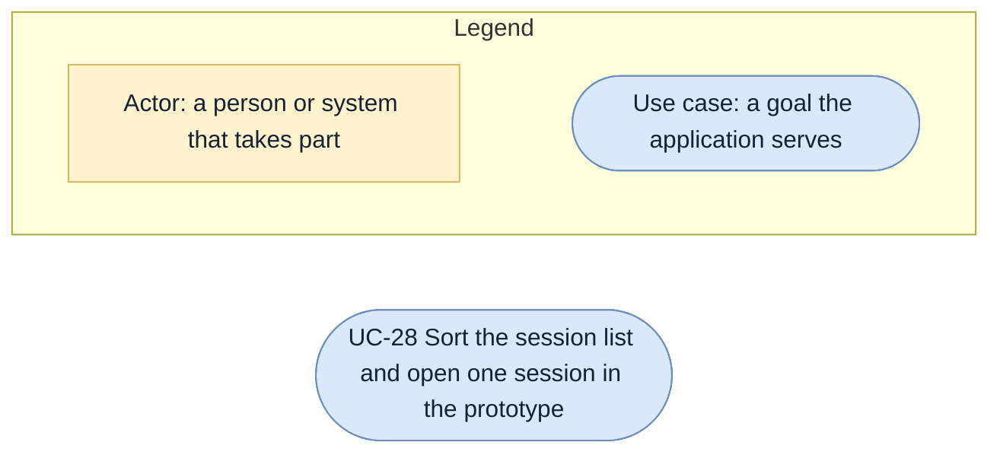

# UC-28 Sort the session list and open one session in the prototype Use Case Diagram

The actors that take part in UC-28 Sort the session list and open one session in the prototype, drawn from the specification.

## Use case diagram

%% generated:diagram-use-case-uc-28 start (do not edit; run brain docs generate) %%

%% generated:diagram-use-case-uc-28 end %%

%% generated:node-citations-use-case-uc-28 start (do not edit; run brain docs generate) %%
### Node citations

- UC-28 Sort the session list and open one session in the prototype: `web/src/prototype/Prototype.tsx:54`, `web/src/prototype/SessionsScreen.tsx:83`, `web/src/prototype/SessionsScreen.tsx:99`
%% generated:node-citations-use-case-uc-28 end %%
