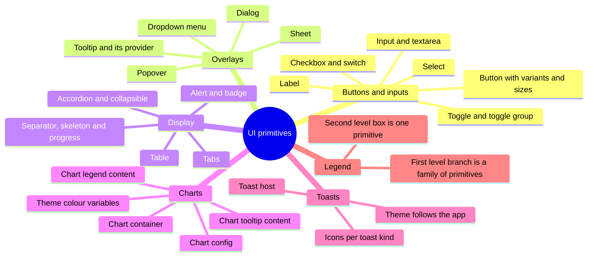

# UI primitives concepts

This map lists the basic interface parts that every dashboard screen is built from, grouped by what they are for. A newcomer can see at once which part to reach for: a button, a pop-up, a table or a chart. It saves a search through two dozen small files.

## What the diagram shows

Buttons and inputs is the first branch: the button with its variants and sizes, the text inputs, the checkbox and switch, the toggles and the select. `web/src/components/ui/button.tsx:40-61` `web/src/components/ui/input.tsx:4-18` `web/src/components/ui/checkbox.tsx:8-29` `web/src/components/ui/toggle-group.tsx:18-47` `web/src/components/ui/select.tsx:6-10`

Overlays is the second branch: the dialog, the sheet, the popover, the tooltip and its provider, and the dropdown menu. `web/src/components/ui/dialog.tsx:10-14` `web/src/components/ui/sheet.tsx:6-8` `web/src/components/ui/popover.tsx:5-9` `web/src/components/ui/tooltip.tsx:20-24` `web/src/components/ui/dropdown-menu.tsx:6-10`

Display is the third branch: the table, tabs, accordion, alert, badge, skeleton and progress bar. `web/src/components/ui/table.tsx:4-17` `web/src/components/ui/tabs.tsx:8-25` `web/src/components/ui/accordion.tsx:8-12` `web/src/components/ui/alert.tsx:21-34` `web/src/components/ui/badge.tsx:28-45` `web/src/components/ui/skeleton.tsx:3-11` `web/src/components/ui/progress.tsx:5-26`

Charts is the fourth branch: the container that carries a config of labels and colours, the tooltip content and the legend content, and the style element that writes the colour variables. `web/src/components/ui/chart.tsx:39-79` `web/src/components/ui/chart.tsx:12-20` `web/src/components/ui/chart.tsx:116-268` `web/src/components/ui/chart.tsx:272-325`

Toasts is the fifth branch: one toast host that picks an icon per toast kind and follows the theme of the app. `web/src/components/ui/sonner.tsx:12-37`

The Legend branch says that a first level branch is a family of primitives and a second level box is one primitive. The names follow the exported names in the files.

## Capability and related functionality

The map realises the lowest layer of the dashboard interface. The explanation of each file is in [[Web ui UI components Overview]], and the structure is in [[UI primitives C4]] and [[UI primitives imports]]. The failure behaviour is in [[UI primitives failure flow]]. The components built on top are in [[Web UI components Overview]].

## UI primitives concepts

%% generated:diagram-ui-primitives-concepts start (do not edit; run brain docs generate) %%

%% generated:diagram-ui-primitives-concepts end %%

> [!example]- Code references
> | Code | What it shows |
> |---|---|
> | `web/src/components/ui/button.tsx:40-61` | Button |
> | `web/src/components/ui/dialog.tsx:10-14` | Dialog |
> | `web/src/components/ui/table.tsx:4-17` | Table |
> | `web/src/components/ui/chart.tsx:39-79` | Chart container |
> | `web/src/components/ui/sonner.tsx:12-37` | Toast host |
