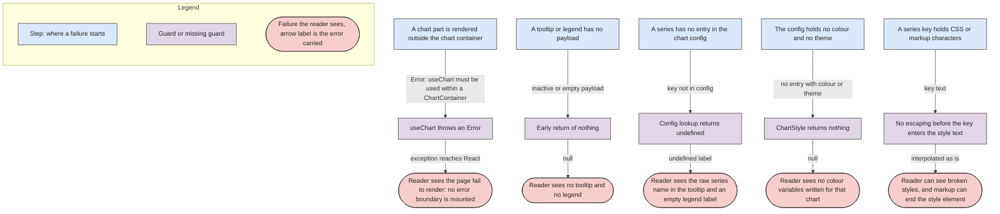

# UI primitives failure flow

This view shows what happens when the chart parts are misused or fed odd data. Most cases end quietly, with no tooltip or a plain name. Two cases are worth a decision: a thrown error that nothing catches, and style text that is built without escaping.

## What the diagram shows

A chart part used outside the chart container throws an error with a fixed message, because the hook that reads the config finds no context. `web/src/components/ui/chart.tsx:29-37` `web/src/components/ui/chart.tsx:33-33`

The app mounts the whole dashboard under one render call with no error boundary around it, so that error is not caught by any component of this repository. `web/src/main.tsx:7-12`

The tooltip content returns nothing when it is inactive or has no payload, and the legend content returns nothing when it has no payload. `web/src/components/ui/chart.tsx:182-183` `web/src/components/ui/chart.tsx:284-285`

When a series has no config entry, the lookup returns undefined, so the tooltip falls back to the raw series name and the legend draws an empty label. `web/src/components/ui/chart.tsx:328-362` `web/src/components/ui/chart.tsx:249-249` `web/src/components/ui/chart.tsx:319-319`

The style element is skipped when no config entry carries a colour or a theme. `web/src/components/ui/chart.tsx:86-87`

The style text is built by putting each config key and colour into a template string and handing it to the browser as HTML, with no escaping. `web/src/components/ui/chart.tsx:102-102` `web/src/components/ui/chart.tsx:92-108`

The time chart fills that config with keys that come from its rows, so a key holding a closing brace or a closing style tag would reach the style text. `web/src/components/chart-time.tsx:65-65`

## Capability and related functionality

The flow covers the chart wrapper, which is the only primitive with its own failure behaviour. The chart is drawn in [[UI primitives C4]] and used by [[Dashboard component composition]]. The wider failure paths of the shared components are in [[Offline and error handling flow]]. The written explanation is in [[Web ui UI components Overview]].

## UI primitives failure flow

%% generated:diagram-ui-primitives-failures start (do not edit; run brain docs generate) %%

%% generated:diagram-ui-primitives-failures end %%

> [!example]- Code references
> | Code | What it shows |
> |---|---|
> | `web/src/components/ui/chart.tsx:33-33` | Context guard |
> | `web/src/main.tsx:7-12` | Single render call without an error boundary |
> | `web/src/components/ui/chart.tsx:182-183` | Tooltip early return |
> | `web/src/components/ui/chart.tsx:284-285` | Legend early return |
> | `web/src/components/ui/chart.tsx:328-362` | Config lookup |
> | `web/src/components/ui/chart.tsx:86-87` | Style element skipped |
> | `web/src/components/ui/chart.tsx:92-108` | Style element filled from the config |
> | `web/src/components/chart-time.tsx:65-65` | Keys come from rows |
