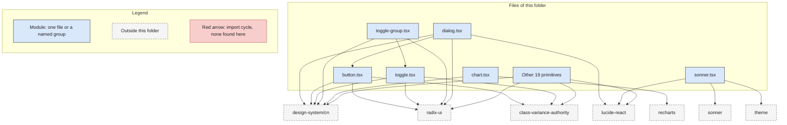

# UI primitives imports

This graph shows what the basic interface parts import. It makes clear that they depend only on a few libraries and one class name helper, never on the dashboard components built from them. A developer can therefore change a primitive without a risk of a circular dependency.

## What the diagram shows

The dialog imports the button for its footer close action, and the toggle group imports the toggle variants. These are the only two imports between files of this folder. `web/src/components/ui/dialog.tsx:8-8` `web/src/components/ui/toggle-group.tsx:6-6`

Nearly every file imports the class name helper from the design system folder. `web/src/components/ui/button.tsx:3-3` `web/src/components/ui/chart.tsx:2-2` `web/src/components/ui/skeleton.tsx:1-1`

Most files build on one Radix part, and the button, badge and alert declare their variants with class-variance-authority. `web/src/components/ui/button.tsx:4-4` `web/src/components/ui/dialog.tsx:6-6` `web/src/components/ui/tabs.tsx:6-6` `web/src/components/ui/button.tsx:2-2` `web/src/components/ui/badge.tsx:2-2` `web/src/components/ui/alert.tsx:2-2`

The dialog and the toast host import icons from lucide-react. `web/src/components/ui/dialog.tsx:5-5` `web/src/components/ui/sonner.tsx:7-7`

The chart file imports recharts, and the toast host imports the sonner library and the theme hook of the web source. `web/src/components/ui/chart.tsx:3-3` `web/src/components/ui/sonner.tsx:8-8` `web/src/components/ui/sonner.tsx:10-10`

No file of this folder imports a file of the shared components folder, so there is no cycle between the two.

## Capability and related functionality

The graph realises the file level view of the primitives layer. The folder level view is [[Web ui UI components Diagrams]], and the grouped view is [[UI primitives C4]]. The components above this layer have their own import graph in [[Shared components imports]].

## UI primitives imports

%% generated:diagram-ui-primitives-imports start (do not edit; run brain docs generate) %%

%% generated:diagram-ui-primitives-imports end %%

> [!example]- Code references
> | Code | What it shows |
> |---|---|
> | `web/src/components/ui/dialog.tsx:8-8` | Dialog imports the button |
> | `web/src/components/ui/toggle-group.tsx:6-6` | Toggle group imports the toggle variants |
> | `web/src/components/ui/button.tsx:3-3` | Class name helper |
> | `web/src/components/ui/button.tsx:2-2` | Variants |
> | `web/src/components/ui/chart.tsx:3-3` | recharts import |
> | `web/src/components/ui/sonner.tsx:10-10` | Theme hook import |
