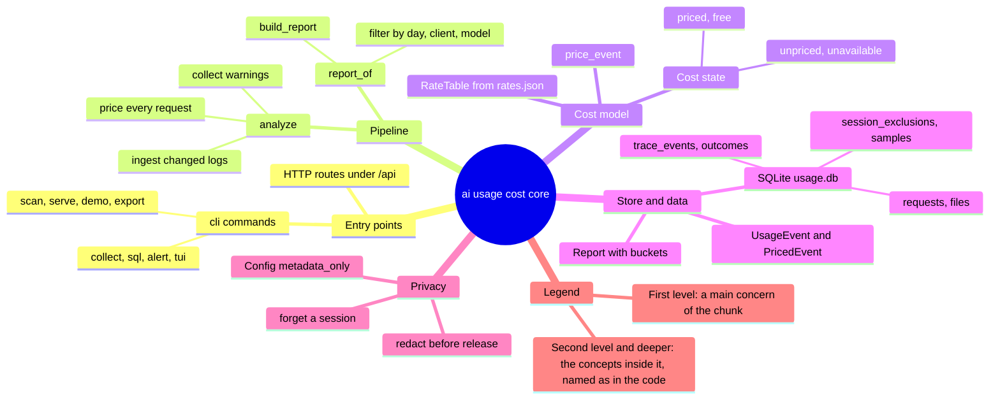

# Usage cost concepts

This picture gives a newcomer the whole core of the tool on one page. It names the five things the core is made of: the ways in, the run that prices usage, the price model, the stored data and the privacy controls. Reading it first makes every other page about the core easier to place.

## What the diagram shows

- The command line offers eight commands: scan, serve, demo, export, collect, sql, alert and tui. `src/ai_usage_cost/cli.py:71-72` `src/ai_usage_cost/cli.py:108-109` `src/ai_usage_cost/cli.py:140-141` `src/ai_usage_cost/cli.py:175-176` `src/ai_usage_cost/cli.py:199-200` `src/ai_usage_cost/cli.py:228-229` `src/ai_usage_cost/cli.py:298-299` `src/ai_usage_cost/cli.py:357-358`
- The HTTP interface is one application whose data routes all start with /api. `src/ai_usage_cost/api.py:198-214` `src/ai_usage_cost/api.py:255`
- The run called analyze ingests changed logs into the store, prices every loaded request and then adds the warnings. `src/ai_usage_cost/pipeline.py:166-199` `src/ai_usage_cost/pipeline.py:212-245`
- A report is a filtered slice of that analysis summarised by build_report. `src/ai_usage_cost/pipeline.py:305-349`
- Prices come from a rate table loaded from rates.json, and price_event returns a cost and one of four cost states. `src/ai_usage_cost/pricing.py:252-287` `src/ai_usage_cost/models.py:8`
- The store is a SQLite file under the home folder that holds requests, files, trace events, outcomes and session exclusions, and the GPU sampler adds a samples table. `src/ai_usage_cost/pipeline.py:28` `src/ai_usage_cost/store.py:21-87` `src/ai_usage_cost/collect.py:18-25`
- Privacy rests on a configuration that starts in metadata only mode, on redaction of any text that is released and on forgetting a session. `src/ai_usage_cost/privacy.py:52-57` `src/ai_usage_cost/privacy.py:78-101` `src/ai_usage_cost/store.py:595-606`

## Capability and related functionality

- The concepts are explained in prose in [[Ai usage cost Overview]], and the terms are drawn with their relations in [[Usage cost terms]].
- The run from logs to report is drawn step by step in [[Scan pipeline from logs to report]], and the price decision in [[How one request is priced]].
- The stored data is in [[Ai usage cost Data Model]] and the routes in [[Usage cost HTTP routes]].
- The privacy controls are explained in [[Ai usage cost Security]].

## Usage cost concepts

%% generated:diagram-usage-cost-concepts start (do not edit; run brain docs generate) %%

%% generated:diagram-usage-cost-concepts end %%

> [!example]- Code references
> | Code | What it shows |
> |---|---|
> | `src/ai_usage_cost/cli.py:24-27` | The command line application |
> | `src/ai_usage_cost/api.py:198-214` | The HTTP application |
> | `src/ai_usage_cost/pipeline.py:166-245` | The analyze run |
> | `src/ai_usage_cost/pricing.py:252-287` | The rate table and its loader |
> | `src/ai_usage_cost/store.py:21-87` | The store tables |
> | `src/ai_usage_cost/privacy.py:52-57` | The privacy configuration |
