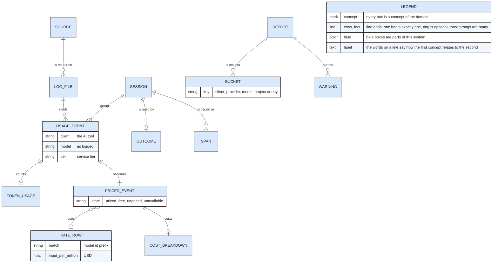

# Usage cost conceptual model

This view names the main things the tool talks about and how they relate: a tool, its log files, the requests inside them, the price rows and the reports. It gives a new reader the vocabulary before any technical page. It also shows that cost belongs to a single request and is only summed later.

## What the diagram shows

- A source is one supported AI coding tool, and it knows how to list its log files. `src/ai_usage_cost/sources/base.py:23`
- Each usage event remembers the file it came from. `src/ai_usage_cost/models.py:67`
- A session is the set of events that share a source and a session id. `src/ai_usage_cost/aggregate.py:582`
- An event may carry token counts, and some tools log none. `src/ai_usage_cost/models.py:57`
- Pricing wraps each event in a priced event that holds a cost state and an optional cost breakdown. `src/ai_usage_cost/models.py:117` `src/ai_usage_cost/models.py:120`
- A priced event uses at most one rate row, found by the model id. `src/ai_usage_cost/pricing.py:431`
- A person can rate a session, and the rating is kept per source and session. `src/ai_usage_cost/store.py:67`
- A session can also be traced as spans. `src/ai_usage_cost/store.py:46`
- A report sums priced events into buckets and carries the warnings. `src/ai_usage_cost/aggregate.py:472` `src/ai_usage_cost/aggregate.py:127`

## Capability and related functionality

- Gives the shared vocabulary for [[Ai usage cost Data Model]], which lists every field of these concepts.
- The tables behind the concepts are drawn in the generated entity view in [[Ai usage cost Diagrams]].
- How a request moves from event to priced event is shown in [[How one request is priced]] and [[Cost state of a request]].

## The diagram

%% generated:diagram-conceptual-usage-cost-model start (do not edit; run brain docs generate) %%

%% generated:diagram-conceptual-usage-cost-model end %%

> [!example]- Code references
> | Code | What it shows |
> |---|---|
> | `src/ai_usage_cost/models.py:49` | The usage event |
> | `src/ai_usage_cost/models.py:117` | The priced event |
> | `src/ai_usage_cost/aggregate.py:462` | The report with its buckets and warnings |
> | `src/ai_usage_cost/sources/base.py:18` | The source description |
> | `src/ai_usage_cost/trace.py:147` | The rating of a session |
