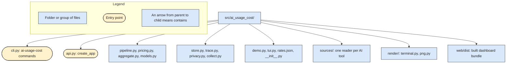

# Usage cost folders

This view shows how the core package is laid out on disk and where a person or another program enters it. The core files sit in one folder, and three sub folders hold the log readers, the output renderers and the built dashboard. It tells a developer where to look before opening any file.

## What the diagram shows

- The installed command is the command line application in the package root. `pyproject.toml:29-30` `src/ai_usage_cost/cli.py:24-27`
- The HTTP application is built by one function in the package root and started by the serve command. `src/ai_usage_cost/api.py:198-214` `src/ai_usage_cost/cli.py:118-137`
- The pipeline, pricing, aggregation and model files hold the cost logic. `src/ai_usage_cost/pipeline.py:166-173` `src/ai_usage_cost/pricing.py:252-253` `src/ai_usage_cost/aggregate.py:462-463`
- The store, trace, privacy and GPU sampler files hold persistence, traces and their controls. `src/ai_usage_cost/store.py:140` `src/ai_usage_cost/trace.py:55` `src/ai_usage_cost/privacy.py:52` `src/ai_usage_cost/collect.py:260`
- The rate table ships as a file next to the code and is read when no other file is given. `src/ai_usage_cost/pricing.py:22` `src/ai_usage_cost/pricing.py:286-287`
- The log readers live in the sources folder and are reached through one registry. `src/ai_usage_cost/pipeline.py:22`
- The terminal and image renderers live in the render folder. `src/ai_usage_cost/cli.py:22` `src/ai_usage_cost/cli.py:190`
- The dashboard bundle is served from web/dist next to the code when it has been built. `src/ai_usage_cost/api.py:41` `src/ai_usage_cost/api.py:394-395`

## Capability and related functionality

- The sub folders are documented as their own chunks: [[Ai usage cost sources Overview]] and [[Ai usage cost render Overview]].
- The dependencies between the files are drawn in [[Ai usage cost Diagrams]], and the concepts in [[Usage cost concepts]].

## Usage cost folders

%% generated:diagram-usage-cost-folders start (do not edit; run brain docs generate) %%

%% generated:diagram-usage-cost-folders end %%

> [!example]- Code references
> | Code | What it shows |
> |---|---|
> | `pyproject.toml:29-30` | The installed command |
> | `src/ai_usage_cost/api.py:41` | The dashboard bundle folder |
> | `src/ai_usage_cost/pipeline.py:22` | The source registry import |
> | `src/ai_usage_cost/cli.py:22` | The render import |
