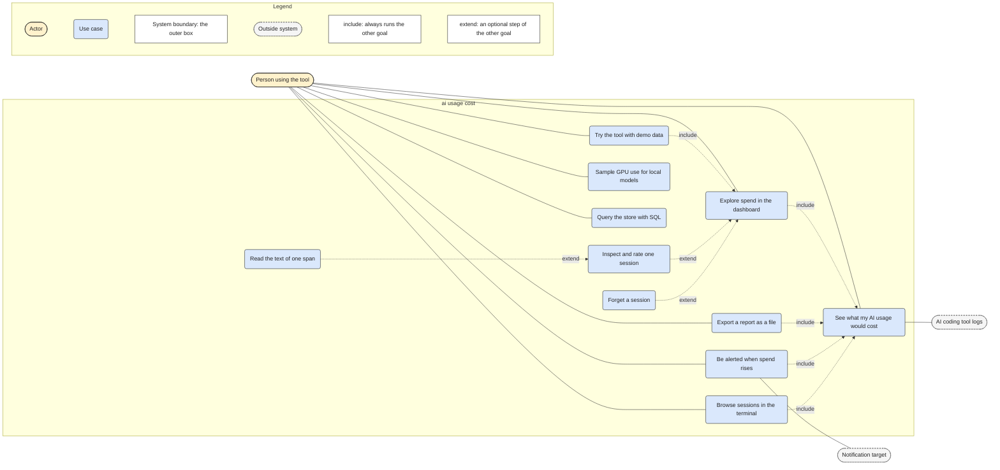

# Usage cost goals

This view lists what a person can get done with the tool and which outside parties take part. Every goal starts from the same step: reading the logs that AI coding tools already keep and pricing them. Seeing the goals together helps decide where a change will be felt.

## What the diagram shows

- There is one human actor and no login: every command is run by the person who owns the machine. `src/ai_usage_cost/cli.py:24-27`
- Seeing the cost means scanning the logs, pricing them and printing a breakdown, and the command exits with code 1 when no usage is found. `src/ai_usage_cost/cli.py:87-105`
- The dashboard, the export, the alert and the terminal browser all start by running the same analysis, which is why they include the first goal. `src/ai_usage_cost/cli.py:125` `src/ai_usage_cost/cli.py:184-185` `src/ai_usage_cost/cli.py:331-332` `src/ai_usage_cost/cli.py:369-370`
- The demo command writes synthetic logs and then serves the dashboard over them with a separate store. `src/ai_usage_cost/cli.py:159-172`
- Inspecting, rating and forgetting a session, and reading the text of one span, are steps inside the dashboard served by session routes. `src/ai_usage_cost/api.py:320-382`
- The alert sends its message to each notification address the person passes. `src/ai_usage_cost/cli.py:344-354`
- The GPU sampler and the SQL browser work on the store directly and do not price anything. `src/ai_usage_cost/cli.py:211-225` `src/ai_usage_cost/cli.py:235-248`

## Capability and related functionality

- Each goal is a use case in the specification note of this chunk, [[Ai usage cost Specification]], with its cited main flow.
- The routes behind the dashboard goals are drawn in [[Usage cost HTTP routes]], and the alert run in [[Spend alert run]].
- The shared first step is drawn in [[Scan pipeline from logs to report]].

## Usage cost goals

%% generated:diagram-usage-cost-goals start (do not edit; run brain docs generate) %%

%% generated:diagram-usage-cost-goals end %%

> [!example]- Code references
> | Code | What it shows |
> |---|---|
> | `src/ai_usage_cost/cli.py:71-376` | The eight commands behind the goals |
> | `src/ai_usage_cost/api.py:320-382` | The session routes behind the dashboard goals |
