# Usage cost refusals

This view collects every way the core can say no, and what the person sees each time. It separates refusals the person is told about from problems the tool absorbs quietly. That second group matters most: a quiet fallback can make the numbers or the privacy settings differ from what the person expects.

## What the diagram shows

- A route that needs the store answers 503 when the analysis was built without one. `src/ai_usage_cost/api.py:219-223`
- A session route answers 404 when the source and session are not stored or the session was forgotten. `src/ai_usage_cost/api.py:234-236` `src/ai_usage_cost/store.py:609-625`
- The content route also answers 404 when the span is not in the session, and when its text is not released or cannot be read. `src/ai_usage_cost/api.py:376-382` `src/ai_usage_cost/privacy.py:86-94`
- A root override without an equals sign and wrong alert options stop the command with a parameter error. `src/ai_usage_cost/cli.py:59-68` `src/ai_usage_cost/cli.py:320-326`
- A badly written since or until date is parsed without a guard, so the person sees a raw error instead of a usage message. `src/ai_usage_cost/cli.py:44-45`
- The sql, tui and alert commands need an optional extra; without it they print the install command and exit with code 2. `src/ai_usage_cost/cli.py:48-56` `src/ai_usage_cost/cli.py:235` `src/ai_usage_cost/cli.py:327` `src/ai_usage_cost/cli.py:366`
- A rate file that fails validation stops the analysis with the validation error, because loading has no handler. `src/ai_usage_cost/pricing.py:286-287` `src/ai_usage_cost/pipeline.py:192`
- Scan and tui exit with code 1 and a hint when no usage is found; export, sql and collect have their own exits for an unknown file type, a missing store and a missing GPU sampler. `src/ai_usage_cost/cli.py:98-104` `src/ai_usage_cost/cli.py:371-375` `src/ai_usage_cost/cli.py:193-195` `src/ai_usage_cost/cli.py:239-244` `src/ai_usage_cost/cli.py:212-217`
- An unreadable or invalid privacy file silently gives the default settings. `src/ai_usage_cost/privacy.py:60-68`
- A log file that cannot be read adds a warning and is skipped, so the scan goes on. `src/ai_usage_cost/store.py:222-226` `src/ai_usage_cost/store.py:256-258`
- A GPU tool that fails, times out or prints something unexpected gives no sample for that tick. `src/ai_usage_cost/collect.py:152-161` `src/ai_usage_cost/collect.py:273-276`

## Capability and related functionality

- The routes refused here are mapped in [[Usage cost HTTP routes]], and the alert refusals are drawn in order in [[Spend alert run]].
- The quiet privacy fallback and the missing caller check are explained in [[Ai usage cost Security]].
- The raw date error and the unhandled rate file error are recorded as risks in [[Ai usage cost Specification]].

## Usage cost refusals

%% generated:diagram-usage-cost-refusals start (do not edit; run brain docs generate) %%

```mermaid
flowchart TD
    subgraph http["HTTP routes"]
        req["Route call"]:::step
        g_store{{"Analysis has a store?"}}:::guard
        g_sess{{"Session stored and not forgotten?"}}:::guard
        g_span{{"Span in the session?"}}:::guard
        g_text{{"Text released and readable?"}}:::guard
        ok_http["Answer the route"]:::step
        e503(["503 built without a store"]):::fail
        e404s(["404 no session"]):::fail
        e404p(["404 no span"]):::fail
        e404c(["404 no readable content"]):::fail
    end
    req --> g_store
    g_store -->|no| e503
    g_store -->|yes| g_sess
    g_sess -->|no| e404s
    g_sess -->|yes, content route| g_span
    g_sess -->|yes, other routes| ok_http
    g_span -->|no| e404p
    g_span -->|yes| g_text
    g_text -->|ContentUnavailable| e404c
    g_text -->|yes| ok_http

    subgraph Legend
        direction LR
        zlegend_a["Step"]:::step
        zlegend_b{{"Guard or validator"}}:::guard
        zlegend_c(["Failure the caller sees"]):::fail
        zlegend_e["An arrow is labelled with the error it carries"]:::step
        zlegend_a ~~~ zlegend_b ~~~ zlegend_c ~~~ zlegend_e
    end

    classDef step fill:#dae8fc,stroke:#222222,color:#222222
    classDef guard fill:#e1d5e7,stroke:#222222,color:#222222
    classDef fail fill:#f8cecc,stroke:#222222,color:#222222
    classDef hidden fill:#f5f5f5,stroke:#666666,color:#222222,stroke-dasharray:4 3
```

%% generated:diagram-usage-cost-refusals end %%

The routes are drawn above; the commands and the problems absorbed without a message are drawn below.

%% generated:diagram-command-refusals start (do not edit; run brain docs generate) %%

```mermaid
flowchart TD
    subgraph cmd["Commands"]
        cli["Command call"]:::step
        g_param{{"Options valid?"}}:::guard
        g_extra{{"Optional extra installed?"}}:::guard
        g_rates["RateTable.load"]:::step
        g_usage{{"Any usage found?"}}:::guard
        ok_cli["Print, write or serve"]:::step
        ebad(["Usage error: bad parameter"]):::fail
        eextra(["Exit 2: install hint"]):::fail
        etrace(["Traceback, exit 1: unhandled error"]):::fail
        enone(["Exit 1: no usage found"]):::fail
    end
    subgraph quiet["Handled without telling the caller"]
        cfg["load_config: unreadable or invalid file"]:::step
        read["ingest: file cannot be read"]:::step
        sample["sample_once: tool fails or times out"]:::step
        cfg_out(["Defaults used, no message"]):::hidden
        read_out(["Warning added, file skipped"]):::hidden
        sample_out(["Sample skipped"]):::hidden
    end

    cli --> g_param
    g_param -->|BadParameter| ebad
    g_param -->|ValueError: bad --since or --until| etrace
    g_param -->|yes| g_extra
    g_extra -->|ImportError| eextra
    g_extra -->|yes| g_rates
    g_rates -->|ValidationError: invalid rates.json| etrace
    g_rates -->|loaded| g_usage
    g_usage -->|no| enone
    g_usage -->|yes| ok_cli

    cfg -->|OSError, ValueError, ValidationError| cfg_out
    read -->|OSError| read_out
    sample -->|OSError, SubprocessError, timeout| sample_out

    subgraph Legend
        direction LR
        zlegend_a["Step"]:::step
        zlegend_b{{"Guard or validator"}}:::guard
        zlegend_c(["Failure the caller sees"]):::fail
        zlegend_d(["Failure hidden from the caller"]):::hidden
        zlegend_e["An arrow is labelled with the error it carries"]:::step
        zlegend_a ~~~ zlegend_b ~~~ zlegend_c ~~~ zlegend_d ~~~ zlegend_e
    end

    classDef step fill:#dae8fc,stroke:#222222,color:#222222
    classDef guard fill:#e1d5e7,stroke:#222222,color:#222222
    classDef fail fill:#f8cecc,stroke:#222222,color:#222222
    classDef hidden fill:#f5f5f5,stroke:#666666,color:#222222,stroke-dasharray:4 3
```

%% generated:diagram-command-refusals end %%

> [!example]- Code references
> | Code | What it shows |
> |---|---|
> | `src/ai_usage_cost/api.py:219-242` | Store and session guards |
> | `src/ai_usage_cost/api.py:370-382` | Span and content guards |
> | `src/ai_usage_cost/cli.py:44-68` | Date parsing, extras and root overrides |
> | `src/ai_usage_cost/privacy.py:60-68` | Silent privacy defaults |
> | `src/ai_usage_cost/store.py:218-258` | Unreadable log files |
> | `src/ai_usage_cost/collect.py:152-161` | GPU tool failures |
