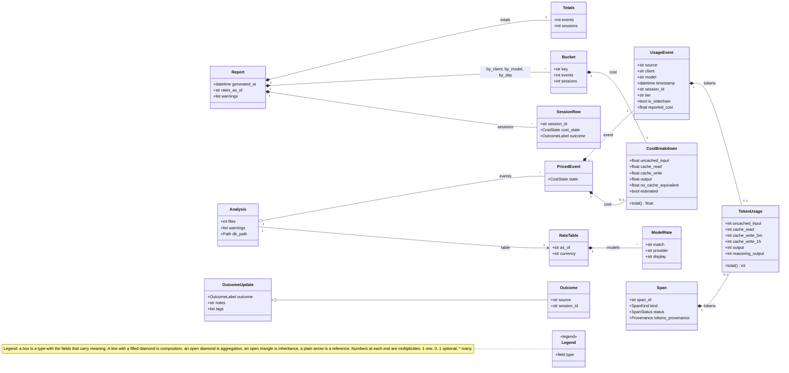

# Usage cost types

This view shows the record types the tool passes around in memory, as opposed to the tables it stores. It explains how one logged request gains a price, how priced requests are summed into a report and how a session rating is shaped. A developer can see at a glance which types to change when a new figure must reach the report.

## What the diagram shows

- A usage event is one logged request with its client, model, time, session, service tier and the cost the tool itself logged, if any. `src/ai_usage_cost/models.py:49-72`
- Its token counts are optional, and the totals are computed from the six counted fields. `src/ai_usage_cost/models.py:12-33` `src/ai_usage_cost/models.py:57`
- A priced event wraps one usage event with an optional cost breakdown and a cost state. `src/ai_usage_cost/models.py:117-120`
- A cost breakdown holds the price of each token kind, a no cache baseline and the estimated flag, and its total is the sum of the four prices. `src/ai_usage_cost/models.py:75-98`
- A bucket sums tokens, cost, requests and sessions under one key. `src/ai_usage_cost/models.py:123-130`
- The analysis holds every priced event, the rate table, the file count, the warnings and the store path. `src/ai_usage_cost/pipeline.py:44-55`
- A rate table holds its as of date, currency and model rows, and each row names the model prefix it matches, its provider and display name. `src/ai_usage_cost/pricing.py:252-260` `src/ai_usage_cost/pricing.py:126-129`
- A report carries totals, buckets by client, provider, model, project and day, session rows and the warnings. `src/ai_usage_cost/aggregate.py:462-482` `src/ai_usage_cost/aggregate.py:26-34`
- A session row carries the worst cost state of its requests and the session rating. `src/ai_usage_cost/aggregate.py:48-75`
- A span is one step of a session trace with its kind, status and the provenance of its token counts. `src/ai_usage_cost/trace.py:55-86`
- An outcome extends the rating update with the source and session it belongs to. `src/ai_usage_cost/trace.py:141-151`

## Capability and related functionality

- The stored form of these types is the entity diagram in [[Ai usage cost Data Model]]; the business view is [[Usage cost conceptual model]].
- The cost state field is drawn as a lifecycle in [[Cost state of a request]].
- The report type is what the routes in [[Usage cost HTTP routes]] return.

## Usage cost types

%% generated:diagram-usage-cost-types start (do not edit; run brain docs generate) %%

%% generated:diagram-usage-cost-types end %%

> [!example]- Code references
> | Code | What it shows |
> |---|---|
> | `src/ai_usage_cost/models.py:12-134` | Token, event, cost, priced event and bucket types |
> | `src/ai_usage_cost/pipeline.py:44-63` | The analysis type |
> | `src/ai_usage_cost/pricing.py:126-145` | A rate row |
> | `src/ai_usage_cost/aggregate.py:26-75` | Totals and session row |
> | `src/ai_usage_cost/aggregate.py:462-482` | The report type |
> | `src/ai_usage_cost/trace.py:55-151` | Span and outcome types |
