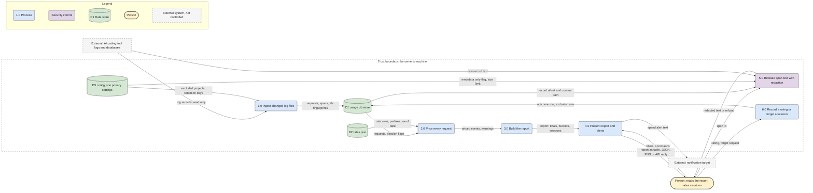

# Usage data flow

This view shows where usage data comes from, where it is kept and who can see it. Logs flow in, prices and settings are read from local files, and the report goes back to the person. It lets a privacy reviewer check that text from a session is only released when the person allows it.

## What the diagram shows

- Source databases are opened read only, so the tool never changes the logs of another tool. `src/ai_usage_cost/sources/base.py:123`
- Ingest records requests, spans and a fingerprint of each file in the store. `src/ai_usage_cost/store.py:281`
- The privacy settings tell ingest which projects to leave out and how long to keep trace rows. `src/ai_usage_cost/pipeline.py:183`
- The rate table is read from a local file and joined to each request. `src/ai_usage_cost/pricing.py:22`
- The settings file sits in the home folder next to the store. `src/ai_usage_cost/privacy.py:12`
- The report goes back to the person as a table, as JSON or as an API reply. `src/ai_usage_cost/cli.py:105` `src/ai_usage_cost/cli.py:96`
- A rating or a forget request writes a row to the store. `src/ai_usage_cost/store.py:568` `src/ai_usage_cost/store.py:595`
- Span text is refused while metadata only is on, and redacted when it is released. `src/ai_usage_cost/privacy.py:87` `src/ai_usage_cost/privacy.py:98`
- The alert command is the one flow that sends data out of the machine, to the targets the person names. `src/ai_usage_cost/cli.py:349`

## Capability and related functionality

- Realises the privacy stance described in [[Ai usage cost Security]].
- The stores D1 to D3 correspond to the tables in [[Ai usage cost Data Model]].
- The order of the same steps over time is [[Scan pipeline from logs to report]].
- The HTTP routes behind the person's requests are in [[Ai usage cost API]].

## The diagram

%% generated:diagram-dfd-usage-data-flow start (do not edit; run brain docs generate) %%

%% generated:diagram-dfd-usage-data-flow end %%

> [!example]- Code references
> | Code | What it shows |
> |---|---|
> | `src/ai_usage_cost/store.py:190` | Process 1.0 |
> | `src/ai_usage_cost/pipeline.py:166` | Process 2.0 |
> | `src/ai_usage_cost/aggregate.py:675` | Process 3.0 |
> | `src/ai_usage_cost/cli.py:299` | The outbound notification |
> | `src/ai_usage_cost/privacy.py:86` | Process 5.0 |
> | `src/ai_usage_cost/store.py:568` | Process 6.0 |
