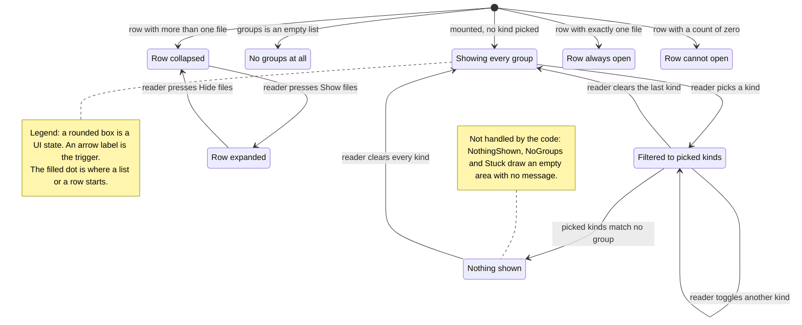

# Warnings list states

This chart shows what a reader sees on the sources screen when the scan reports warnings. It makes clear which views exist and what moves between them. It also marks three views where the code draws nothing and gives no hint why.

## What the diagram shows

A warnings list starts with no kind picked, and while that list is empty it shows every group. `web/src/components/states.tsx:248-249` `web/src/components/states.tsx:249-249`

The row of kind toggles is drawn only when there is more than one group, and each toggle carries the number of instances of its kind. `web/src/components/states.tsx:253-269`

Picking one or more kinds keeps only the groups whose kind is in the picked list, and clearing the last pick brings every group back. `web/src/components/states.tsx:249-249`

The groups are drawn through a plain map over the shown groups, so an empty result draws an empty area and no message. `web/src/components/states.tsx:272-274`

A group row starts collapsed, and its Show files button exists only when the group counts more than one instance. `web/src/components/states.tsx:203-203` `web/src/components/states.tsx:224-225`

The instance list is drawn when the row is expanded or when the count is exactly one, so a row with a count of zero can never open. `web/src/components/states.tsx:230-230`

## Capability and related functionality

The chart belongs to the warnings list of the shared page states, used by the sources screen. The explanation of the parts is in [[Web UI components Overview]], and the failure paths are in [[Offline and error handling flow]]. The tests of this folder are listed in [[Web UI components Tests]], and none of them covers the warnings list.

## Warnings list states

%% generated:diagram-warnings-list-states start (do not edit; run brain docs generate) %%

%% generated:diagram-warnings-list-states end %%

> [!example]- Code references
> | Code | What it shows |
> |---|---|
> | `web/src/components/states.tsx:248-249` | Initial kind list |
> | `web/src/components/states.tsx:253-269` | Kind toggles |
> | `web/src/components/states.tsx:249-249` | Filter by kind |
> | `web/src/components/states.tsx:272-274` | Rows drawn from the shown groups |
> | `web/src/components/states.tsx:224-225` | Show files button |
> | `web/src/components/states.tsx:230-230` | Instance list condition |
