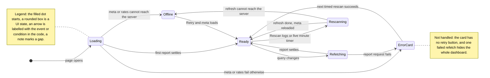

# Web App Load State Chart

This chart shows what the reader sees while the dashboard starts, refreshes and fails. It explains why the whole page can turn into an error card and how it comes back. It matters because every view depends on these states.

## What the diagram shows

- The page starts in a loading state that ends when the first report has settled `web/src/App.tsx:139-139` `web/src/App.tsx:195-198`.
- A failure whose text says the server cannot be reached shows the offline card, and its retry reloads the metadata `web/src/App.tsx:251-259` `web/src/api.ts:493-494`.
- Any other error shows the error card `web/src/App.tsx:271-271`.
- A query change starts a new report request, and the count line dims while it runs `web/src/App.tsx:186-201` `web/src/App.tsx:203-203`.
- A rescan runs on the button and every five minutes while the page is visible, and a successful one reloads the metadata and clears the error `web/src/App.tsx:211-222` `web/src/App.tsx:226-243` `web/src/App.tsx:172-172`.

## Capability and related functionality

The states belong to [[App Screen]]. The failures are traced further in [[Web Error Flow]], and the session level states are in [[Web Workspace State Chart]].

## Web App Load State Chart

%% generated:diagram-web-app-loading start (do not edit; run brain docs generate) %%

%% generated:diagram-web-app-loading end %%

> [!example]- Code references
> | Code | What it shows |
> |---|---|
> | `web/src/App.tsx:139-139` | The page starts in a loading state that ends when the first report has settled |
> | `web/src/App.tsx:195-198` | The page starts in a loading state that ends when the first report has settled |
> | `web/src/App.tsx:251-259` | A failure whose text says the server cannot be reached shows the offline card, and its retry reloads the metadata |
> | `web/src/api.ts:493-494` | A failure whose text says the server cannot be reached shows the offline card, and its retry reloads the metadata |
> | `web/src/App.tsx:271-271` | Any other error shows the error card |
> | `web/src/App.tsx:186-201` | A query change starts a new report request, and the count line dims while it runs |
> | `web/src/App.tsx:203-203` | A query change starts a new report request, and the count line dims while it runs |
> | `web/src/App.tsx:211-222` | A rescan runs on the button and every five minutes while the page is visible, and a successful one reloads the metadata and clears the error |
> | `web/src/App.tsx:226-243` | A rescan runs on the button and every five minutes while the page is visible, and a successful one reloads the metadata and clears the error |
> | `web/src/App.tsx:172-172` | A rescan runs on the button and every five minutes while the page is visible, and a successful one reloads the metadata and clears the error |
