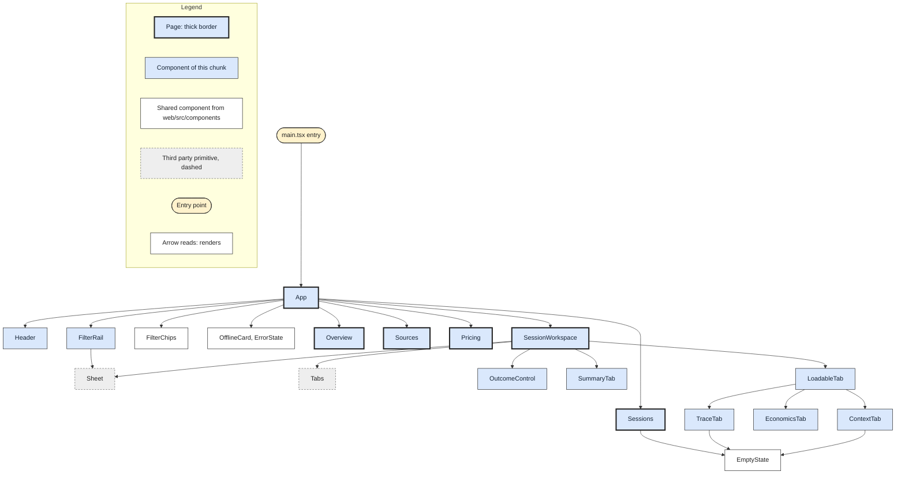

# Web Component Composition

This picture shows which part of the dashboard draws which other part. It helps a developer find where a piece of the screen lives before changing it. Shared parts are drawn once, so a reader sees how far a change to one of them reaches.

## What the diagram shows

- The entry file mounts the App component inside a tooltip provider `web/src/main.tsx:7-12`.
- App renders the header, the filter rail, the filter chips, the offline and error cards, one of four views and the workspace `web/src/App.tsx:255-255` `web/src/App.tsx:274-274` `web/src/App.tsx:292-304` `web/src/App.tsx:307-318` `web/src/App.tsx:327-327` `web/src/App.tsx:330-340` `web/src/App.tsx:343-352`.
- The filter rail renders its content twice, as a docked aside and inside a sheet `web/src/FilterRail.tsx:477-503`.
- The workspace renders the outcome control, the tab list and a loading wrapper around the trace, economics and context tabs `web/src/SessionWorkspace.tsx:533-533` `web/src/SessionWorkspace.tsx:536-596`.
- Sessions, Trace and Context render the shared empty state `web/src/Sessions.tsx:299-299` `web/src/TraceTab.tsx:980-980` `web/src/ContextTab.tsx:166-166`.

## Capability and related functionality

The composition sits under [[App Screen]] and the screen notes such as [[Session Workspace Screen]]. The C4 view of the same code is [[Web Dashboard Components]] and the folders are in [[Web Package Tree]].

## Web Component Composition

%% generated:diagram-web-ui-composition start (do not edit; run brain docs generate) %%

%% generated:diagram-web-ui-composition end %%

> [!example]- Code references
> | Code | What it shows |
> |---|---|
> | `web/src/main.tsx:7-12` | The entry file mounts the App component inside a tooltip provider |
> | `web/src/App.tsx:255-255` | App renders the header, the filter rail, the filter chips, the offline and error cards, one of four views and the workspace |
> | `web/src/App.tsx:274-274` | App renders the header, the filter rail, the filter chips, the offline and error cards, one of four views and the workspace |
> | `web/src/App.tsx:292-304` | App renders the header, the filter rail, the filter chips, the offline and error cards, one of four views and the workspace |
> | `web/src/App.tsx:307-318` | App renders the header, the filter rail, the filter chips, the offline and error cards, one of four views and the workspace |
> | `web/src/App.tsx:327-327` | App renders the header, the filter rail, the filter chips, the offline and error cards, one of four views and the workspace |
> | `web/src/App.tsx:330-340` | App renders the header, the filter rail, the filter chips, the offline and error cards, one of four views and the workspace |
> | `web/src/App.tsx:343-352` | App renders the header, the filter rail, the filter chips, the offline and error cards, one of four views and the workspace |
> | `web/src/FilterRail.tsx:477-503` | The filter rail renders its content twice, as a docked aside and inside a sheet |
> | `web/src/SessionWorkspace.tsx:533-533` | The workspace renders the outcome control, the tab list and a loading wrapper around the trace, economics and context tabs |
> | `web/src/SessionWorkspace.tsx:536-596` | The workspace renders the outcome control, the tab list and a loading wrapper around the trace, economics and context tabs |
> | `web/src/Sessions.tsx:299-299` | Sessions, Trace and Context render the shared empty state |
> | `web/src/TraceTab.tsx:980-980` | Sessions, Trace and Context render the shared empty state |
> | `web/src/ContextTab.tsx:166-166` | Sessions, Trace and Context render the shared empty state |
