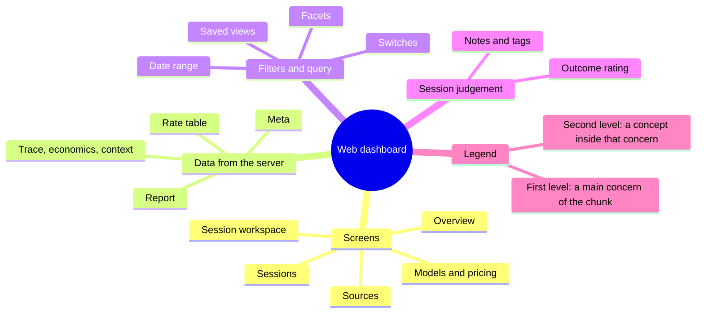

# Web Concept Map

This picture gives a newcomer the main ideas of the dashboard on one page. It groups them into what the reader sees, what comes from the server, how the slice is narrowed and how a session is judged. It is the starting point before reading the screen maps.

## What the diagram shows

- The screens are the four views in the header tab strip plus the session workspace `web/src/Header.tsx:24-24` `web/src/App.tsx:342-342`.
- The data comes from the metadata, rate table and report requests, and from the per session trace, economics and context requests `web/src/api.ts:502-511` `web/src/api.ts:543-555`.
- The query holds search, cost states, clients, models, projects, outcomes and three switches `web/src/App.tsx:23-35`.
- A session is judged with an outcome label plus notes and tags `web/src/SessionWorkspace.tsx:79-79` `web/src/SessionWorkspace.tsx:244-248`.

## Capability and related functionality

The concepts are drawn as related terms in [[Web Glossary Map]], the screens in [[Web Sitemap]] and the files in [[Web Package Tree]]. The notes of the chunk are [[Web Overview]], [[Web Workflows]] and [[Web Data Model]].

## Web Concept Map

%% generated:diagram-web-concepts start (do not edit; run brain docs generate) %%

%% generated:diagram-web-concepts end %%

> [!example]- Code references
> | Code | What it shows |
> |---|---|
> | `web/src/Header.tsx:24-24` | The screens are the four views in the header tab strip plus the session workspace |
> | `web/src/App.tsx:342-342` | The screens are the four views in the header tab strip plus the session workspace |
> | `web/src/api.ts:502-511` | The data comes from the metadata, rate table and report requests, and from the per session trace, economics and context requests |
> | `web/src/api.ts:543-555` | The data comes from the metadata, rate table and report requests, and from the per session trace, economics and context requests |
> | `web/src/App.tsx:23-35` | The query holds search, cost states, clients, models, projects, outcomes and three switches |
> | `web/src/SessionWorkspace.tsx:79-79` | A session is judged with an outcome label plus notes and tags |
> | `web/src/SessionWorkspace.tsx:244-248` | A session is judged with an outcome label plus notes and tags |
