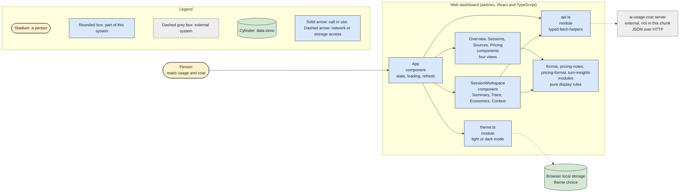

# Web Dashboard Components

This view shows how the local dashboard is put together, from the person reading it to the server that holds the numbers. It lets a new team member see which part loads data, which part shows it and which part only formats it. It also makes clear that the page itself calculates nothing and only asks the server.

## What the diagram shows

- The person opens the page, which mounts one top level component inside a tooltip provider `web/src/main.tsx:7-13`.
- That component loads the metadata, the rate table and the report, and holds the query, the view and the open session `web/src/App.tsx:132-145` `web/src/App.tsx:166-201`.
- All network calls go through one module of typed helpers that talk to the local server over relative paths `web/src/api.ts:489-512`.
- The component shows one of four views, overview, sessions, sources or pricing, once their data has arrived `web/src/App.tsx:330-339`.
- Opening a session shows the workspace with four tabs, and each tab fetches its own data from the same helper module when first requested `web/src/SessionWorkspace.tsx:72-77` `web/src/SessionWorkspace.tsx:457-474`.
- The views and the workspace use small pure modules for money, token and date formatting, price notes, price text and per turn insights `web/src/format.ts:19-27` `web/src/pricing-notes.ts:27-34` `web/src/pricing-format.ts:83-90` `web/src/turn-insights.ts:73-82`.
- The theme module reads the saved choice from browser local storage and writes it back when the mode changes `web/src/theme.ts:12-33` `web/src/theme.ts:42-47`.

## Capability and related functionality

The diagram realises the usage and cost dashboard. It sits above [[Web Overview]], which lists every file and explains the data flow in prose, and next to the generated module view in [[Web Diagrams]]. The tests behind the pure modules are listed in [[Web Tests]].

## Diagram

%% generated:diagram-web-src-dashboard-c4 start (do not edit; run brain docs generate) %%

%% generated:diagram-web-src-dashboard-c4 end %%

> [!example]- Code references
> | Code | What it shows |
> |---|---|
> | `web/src/main.tsx:7-13` | The entry point mounts the app |
> | `web/src/App.tsx:166-201` | Metadata, rates and report loading |
> | `web/src/api.ts:489-512` | The single fetch helper and the metadata and rate endpoints |
> | `web/src/App.tsx:330-339` | The four views |
> | `web/src/SessionWorkspace.tsx:457-474` | Lazy loading of the workspace tabs |
> | `web/src/theme.ts:12-33` | Theme choice kept in local storage |
