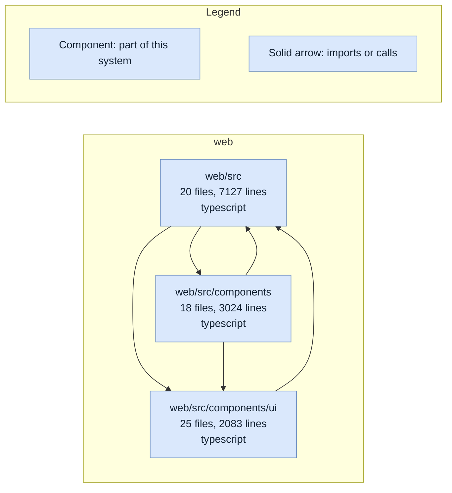

# Web Diagrams

Generated views of the Web chunk; hand-laid views are added next to them.

## Components around Web

%% generated:diagram-module-ch-localtokenomics-web-src start (do not edit; run brain docs generate) %%

%% generated:diagram-module-ch-localtokenomics-web-src end %%

## Hand-laid views

Screens, each with a numbered screen map and a callout table: [[App Screen]], [[Overview Screen]], [[Sessions Screen]], [[Sources Screen]], [[Pricing Screen]], [[Session Workspace Screen]], [[Trace Tab Screen]], [[Context Tab Screen]] and [[Economics Tab Screen]].

Structure and navigation: [[Web Dashboard Components]], [[Web Component Composition]], [[Web Package Tree]], [[Web Sitemap]], [[Web Screen Flow]], [[Web User Journey]], [[Web Concept Map]] and [[Web Glossary Map]].

Forms, tables and dialogs: [[Web Outcome Form Wireframe]], [[Web Filter Rail Wireframe]], [[Web Sessions Table Wireframe]], [[Web Rate Table Wireframe]] and [[Web Workspace Panel Wireframe]].

States and failures: [[Web App Load State Chart]], [[Web Workspace State Chart]], [[Web Outcome Save State Chart]], [[Web Trace State Chart]], [[Web Sessions Table State Chart]] and [[Web Error Flow]].
