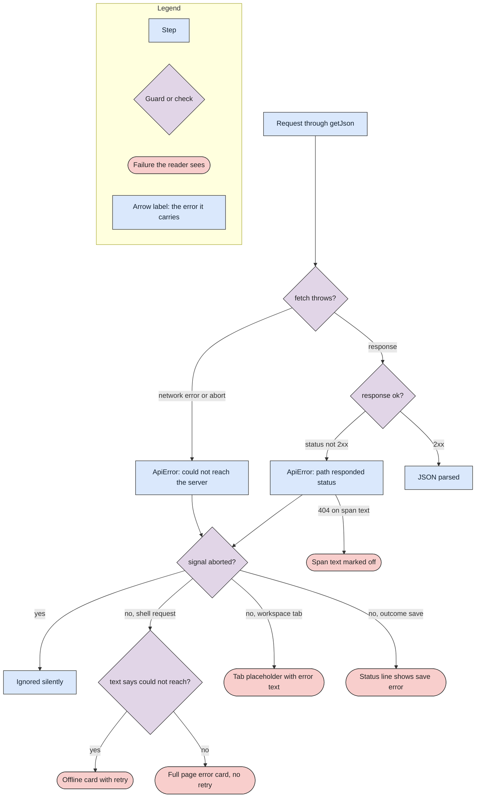

# Web Error Flow

This flow shows how a failed request reaches the reader and where it is caught. Every request goes through one helper, so all failures start in the same two shapes. The flow also shows where a failure hides the whole dashboard and where it only touches one panel.

## What the diagram shows

- Every request goes through one helper that turns a thrown fetch into an unreachable error and a non 2xx answer into a status error `web/src/api.ts:489-499`.
- An aborted request also throws inside fetch, and every caller checks the abort signal before showing anything `web/src/App.tsx:176-176` `web/src/SessionWorkspace.tsx:104-104`.
- The shell shows the offline card when the error text names the unreachable server, and the error card otherwise `web/src/App.tsx:251-259` `web/src/App.tsx:271-271`.
- A workspace tab shows the error text in its placeholder `web/src/SessionWorkspace.tsx:389-390`.
- A failed outcome save shows its error in the status line `web/src/SessionWorkspace.tsx:287-287` `web/src/SessionWorkspace.tsx:298-298`.
- A 404 on span text marks the text off instead of failed `web/src/TraceTab.tsx:59-61` `web/src/TraceTab.tsx:796-796`.

## Capability and related functionality

The shell states are in [[Web App Load State Chart]], the tab states in [[Web Workspace State Chart]] and the span text states in [[Web Trace State Chart]]. The risks these gaps create are recorded in [[Web Specification]].

## Web Error Flow

%% generated:diagram-web-failures start (do not edit; run brain docs generate) %%

%% generated:diagram-web-failures end %%

> [!example]- Code references
> | Code | What it shows |
> |---|---|
> | `web/src/api.ts:489-499` | Every request goes through one helper that turns a thrown fetch into an unreachable error and a non 2xx answer into a status error |
> | `web/src/App.tsx:176-176` | An aborted request also throws inside fetch, and every caller checks the abort signal before showing anything |
> | `web/src/SessionWorkspace.tsx:104-104` | An aborted request also throws inside fetch, and every caller checks the abort signal before showing anything |
> | `web/src/App.tsx:251-259` | The shell shows the offline card when the error text names the unreachable server, and the error card otherwise |
> | `web/src/App.tsx:271-271` | The shell shows the offline card when the error text names the unreachable server, and the error card otherwise |
> | `web/src/SessionWorkspace.tsx:389-390` | A workspace tab shows the error text in its placeholder |
> | `web/src/SessionWorkspace.tsx:287-287` | A failed outcome save shows its error in the status line |
> | `web/src/SessionWorkspace.tsx:298-298` | A failed outcome save shows its error in the status line |
> | `web/src/TraceTab.tsx:59-61` | A 404 on span text marks the text off instead of failed |
> | `web/src/TraceTab.tsx:796-796` | A 404 on span text marks the text off instead of failed |
