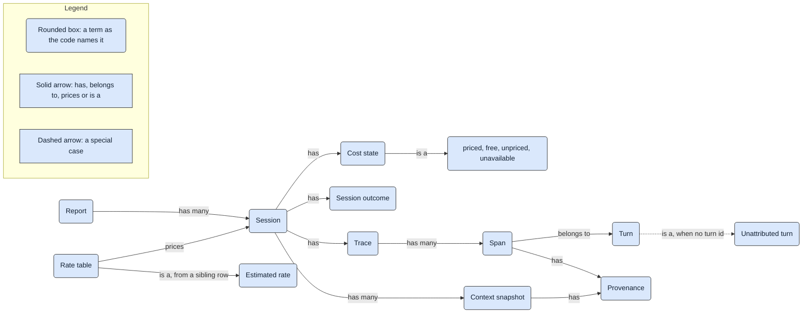

# Web Glossary Map

This map shows the words the dashboard uses and how they relate. It helps a reader understand that a session has a cost state, an outcome and a trace made of spans grouped into turns. The same words appear on every screen.

## What the diagram shows

- The report carries the sessions of the slice, each with a cost state, its other states and an outcome `web/src/api.ts:215-240`.
- A cost state is one of priced, free, unpriced or unavailable `web/src/api.ts:61-61`.
- A provenance word says where a figure came from `web/src/api.ts:63-63`.
- A trace holds spans, and spans are grouped by turn, with spans outside any turn in their own row `web/src/api.ts:195-202` `web/src/TraceTab.tsx:566-566`.
- A context snapshot is one model call with its occupancy and provenance `web/src/api.ts:124-137`.
- An estimated rate prices a model from a sibling row `web/src/Pricing.tsx:62-68`.

## Capability and related functionality

The glossary entries Cost state, Provenance, Estimated rate, Session outcome and Unattributed turn are in [[Web Specification]]. The concepts are grouped by concern in [[Web Concept Map]], and the data shapes are in [[Web Data Model]].

## Web Glossary Map

%% generated:diagram-web-terms start (do not edit; run brain docs generate) %%

%% generated:diagram-web-terms end %%

> [!example]- Code references
> | Code | What it shows |
> |---|---|
> | `web/src/api.ts:215-240` | The report carries the sessions of the slice, each with a cost state, its other states and an outcome |
> | `web/src/api.ts:61-61` | A cost state is one of priced, free, unpriced or unavailable |
> | `web/src/api.ts:63-63` | A provenance word says where a figure came from |
> | `web/src/api.ts:195-202` | A trace holds spans, and spans are grouped by turn, with spans outside any turn in their own row |
> | `web/src/TraceTab.tsx:566-566` | A trace holds spans, and spans are grouped by turn, with spans outside any turn in their own row |
> | `web/src/api.ts:124-137` | A context snapshot is one model call with its occupancy and provenance |
> | `web/src/Pricing.tsx:62-68` | An estimated rate prices a model from a sibling row |
