# Web Outcome Save State Chart

This chart shows how a reader's judgement of a session is kept. A rating is stored the moment it is picked, and notes and tags are stored when the reader leaves the field. The chart also shows what the reader sees when a save fails.

## What the diagram shows

- The stored outcome is fetched when the workspace opens, for every session `web/src/SessionWorkspace.tsx:471-471`.
- Typing changes only the local draft `web/src/SessionWorkspace.tsx:345-345` `web/src/SessionWorkspace.tsx:355-355`.
- Leaving a field saves only when notes or tags differ from what is stored `web/src/SessionWorkspace.tsx:291-294`.
- Picking a rating saves at once `web/src/SessionWorkspace.tsx:312-312`.
- A save sets saving, then stores the answer or keeps the draft and shows the error `web/src/SessionWorkspace.tsx:274-288`.
- The status line shows saving, the save error, the load error, the rated time or not rated yet `web/src/SessionWorkspace.tsx:296-301`.

## Capability and related functionality

The form is drawn in [[Web Outcome Form Wireframe]] and sits on [[Session Workspace Screen]]. Rating a session is a use case in [[Web Specification]].

## Web Outcome Save State Chart

%% generated:diagram-web-outcome-save start (do not edit; run brain docs generate) %%

```mermaid
stateDiagram-v2
    direction LR
    [*] --> Loading: workspace opens
    Loading --> Stored: outcome loaded
    Loading --> LoadError: outcome request fails
    Stored --> Editing: notes or tags typed
    LoadError --> Editing: notes or tags typed
    Editing --> Editing: blur with no change
    Editing --> Saving: blur with a change
    Stored --> Saving: rating picked
    LoadError --> Saving: rating picked
    Saving --> Stored: server answers
    Saving --> SaveError: save fails
    SaveError --> Saving: rating picked or field edited
    note right of Saving
        Not handled: saves are not queued; a second save can start while the first runs.
    end note
    note left of Loading
        Legend: the filled dot starts, a rounded box is a state of the outcome form, an arrow is labelled with the event in the code, a note marks a gap.
    end note
```

%% generated:diagram-web-outcome-save end %%

> [!example]- Code references
> | Code | What it shows |
> |---|---|
> | `web/src/SessionWorkspace.tsx:471-471` | The stored outcome is fetched when the workspace opens, for every session |
> | `web/src/SessionWorkspace.tsx:345-345` | Typing changes only the local draft |
> | `web/src/SessionWorkspace.tsx:355-355` | Typing changes only the local draft |
> | `web/src/SessionWorkspace.tsx:291-294` | Leaving a field saves only when notes or tags differ from what is stored |
> | `web/src/SessionWorkspace.tsx:312-312` | Picking a rating saves at once |
> | `web/src/SessionWorkspace.tsx:274-288` | A save sets saving, then stores the answer or keeps the draft and shows the error |
> | `web/src/SessionWorkspace.tsx:296-301` | The status line shows saving, the save error, the load error, the rated time or not rated yet |
