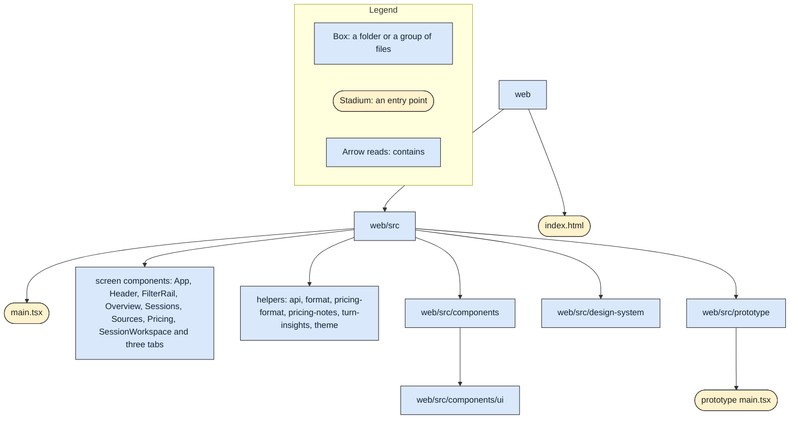

# Web Package Tree

This tree shows how the dashboard's files are laid out on disk. It helps a developer see which folder belongs to this part of the documentation and which belong to its neighbours. The two entry points show where the page and the prototype start.

## What the diagram shows

- The page starts at the entry file, which mounts App with the theme stylesheet `web/src/main.tsx:3-7`.
- App imports the screen components and the helpers that sit beside it in the same folder `web/src/App.tsx:3-12`.
- Shared components and the design system are imported through the at sign alias `web/src/App.tsx:14-18`.
- The theme is applied before the page loads by a script in the HTML file `web/index.html:11-11`.

## Capability and related functionality

This chunk owns the files directly in web/src and in the design system. The folders web/src/components, web/src/components/ui and web/src/prototype belong to their own chunks, described in [[Web UI components Overview]], [[Web ui UI components Overview]] and [[Web prototype Overview]]. The composition of the screens is [[Web Component Composition]].

## Web Package Tree

%% generated:diagram-web-folders start (do not edit; run brain docs generate) %%

%% generated:diagram-web-folders end %%

> [!example]- Code references
> | Code | What it shows |
> |---|---|
> | `web/src/main.tsx:3-7` | The page starts at the entry file, which mounts App with the theme stylesheet |
> | `web/src/App.tsx:3-12` | App imports the screen components and the helpers that sit beside it in the same folder |
> | `web/src/App.tsx:14-18` | Shared components and the design system are imported through the at sign alias |
> | `web/index.html:11-11` | The theme is applied before the page loads by a script in the HTML file |
