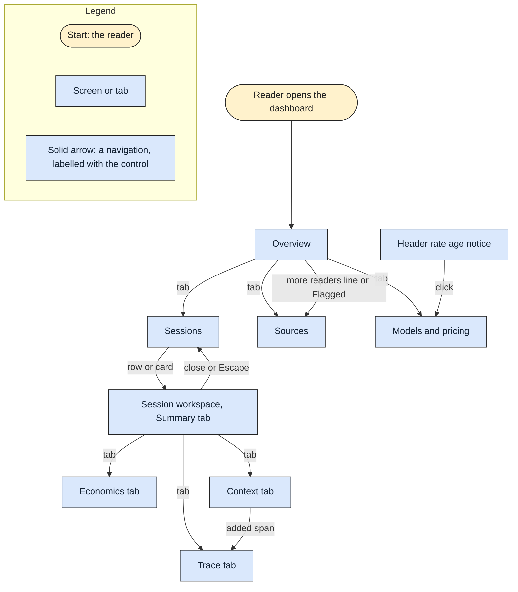

# Web Screen Flow

This flow shows how a reader moves between the screens of the dashboard. It makes clear which controls lead where, including the shortcuts from the overview and the header. It helps a designer see that the dashboard has no page addresses and keeps the place in memory only.

## What the diagram shows

- The header tab strip switches between Overview, Sessions, Sources and Models and pricing `web/src/Header.tsx:24-24` `web/src/Header.tsx:84-84`.
- The rate age notice opens Models and pricing `web/src/Header.tsx:107-107`.
- The overview opens Sources from the more readers line and from the Flagged figure `web/src/Overview.tsx:153-153` `web/src/Overview.tsx:329-329`.
- A session row or card opens the workspace on its Summary tab `web/src/App.tsx:284-287` `web/src/Sessions.tsx:354-354`.
- An added span button on the Context tab jumps to the Trace tab `web/src/SessionWorkspace.tsx:481-484`.
- The workspace closes with its close button or with Escape when docked `web/src/SessionWorkspace.tsx:527-527` `web/src/SessionWorkspace.tsx:489-489`.
- The view is plain component state, so a page reload returns to the overview `web/src/App.tsx:136-136`.

## Capability and related functionality

The screens are documented in [[App Screen]], [[Overview Screen]], [[Sessions Screen]], [[Sources Screen]], [[Pricing Screen]] and [[Session Workspace Screen]]. The structure without the transitions is [[Web Sitemap]], and a full walk is [[Web User Journey]].

## Web Screen Flow

%% generated:diagram-web-navigation start (do not edit; run brain docs generate) %%

%% generated:diagram-web-navigation end %%

> [!example]- Code references
> | Code | What it shows |
> |---|---|
> | `web/src/Header.tsx:24-24` | The header tab strip switches between Overview, Sessions, Sources and Models and pricing |
> | `web/src/Header.tsx:84-84` | The header tab strip switches between Overview, Sessions, Sources and Models and pricing |
> | `web/src/Header.tsx:107-107` | The rate age notice opens Models and pricing |
> | `web/src/Overview.tsx:153-153` | The overview opens Sources from the more readers line and from the Flagged figure |
> | `web/src/Overview.tsx:329-329` | The overview opens Sources from the more readers line and from the Flagged figure |
> | `web/src/App.tsx:284-287` | A session row or card opens the workspace on its Summary tab |
> | `web/src/Sessions.tsx:354-354` | A session row or card opens the workspace on its Summary tab |
> | `web/src/SessionWorkspace.tsx:481-484` | An added span button on the Context tab jumps to the Trace tab |
> | `web/src/SessionWorkspace.tsx:527-527` | The workspace closes with its close button or with Escape when docked |
> | `web/src/SessionWorkspace.tsx:489-489` | The workspace closes with its close button or with Escape when docked |
> | `web/src/App.tsx:136-136` | The view is plain component state, so a page reload returns to the overview |
