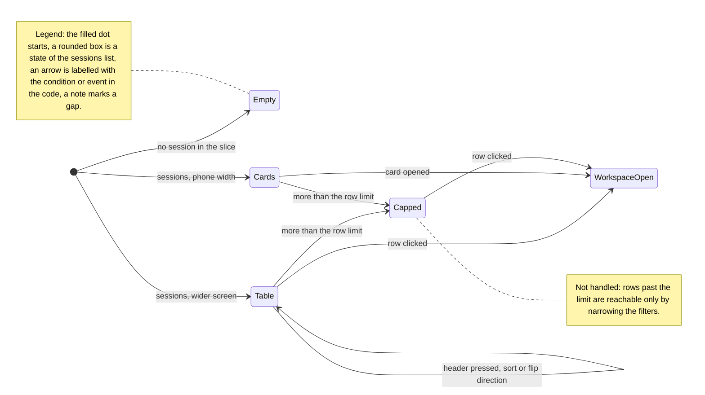

# Web Sessions Table State Chart

This chart shows the shapes the session list can take. It helps a reader understand why they may see cards, a table or a message, and why some sessions are not listed. It also shows that opening any row leads to the session workspace.

## What the diagram shows

- An empty slice shows an empty state, a phone shows cards, and a wider screen shows the table `web/src/Sessions.tsx:298-327`.
- A header press sorts by its column or flips the direction `web/src/Sessions.tsx:259-262`.
- Only the first rows up to the limit are drawn, and the note says how many are hidden `web/src/Sessions.tsx:48-48` `web/src/Sessions.tsx:375-377`.
- A row or a card opens the workspace `web/src/Sessions.tsx:323-323` `web/src/Sessions.tsx:354-354`.

## Capability and related functionality

The chart belongs to [[Sessions Screen]] and its table is drawn in [[Web Sessions Table Wireframe]]. Opening a row leads to [[Session Workspace Screen]].

## Web Sessions Table State Chart

%% generated:diagram-web-sessions-view start (do not edit; run brain docs generate) %%

%% generated:diagram-web-sessions-view end %%

> [!example]- Code references
> | Code | What it shows |
> |---|---|
> | `web/src/Sessions.tsx:298-327` | An empty slice shows an empty state, a phone shows cards, and a wider screen shows the table |
> | `web/src/Sessions.tsx:259-262` | A header press sorts by its column or flips the direction |
> | `web/src/Sessions.tsx:48-48` | Only the first rows up to the limit are drawn, and the note says how many are hidden |
> | `web/src/Sessions.tsx:375-377` | Only the first rows up to the limit are drawn, and the note says how many are hidden |
> | `web/src/Sessions.tsx:323-323` | A row or a card opens the workspace |
> | `web/src/Sessions.tsx:354-354` | A row or a card opens the workspace |
