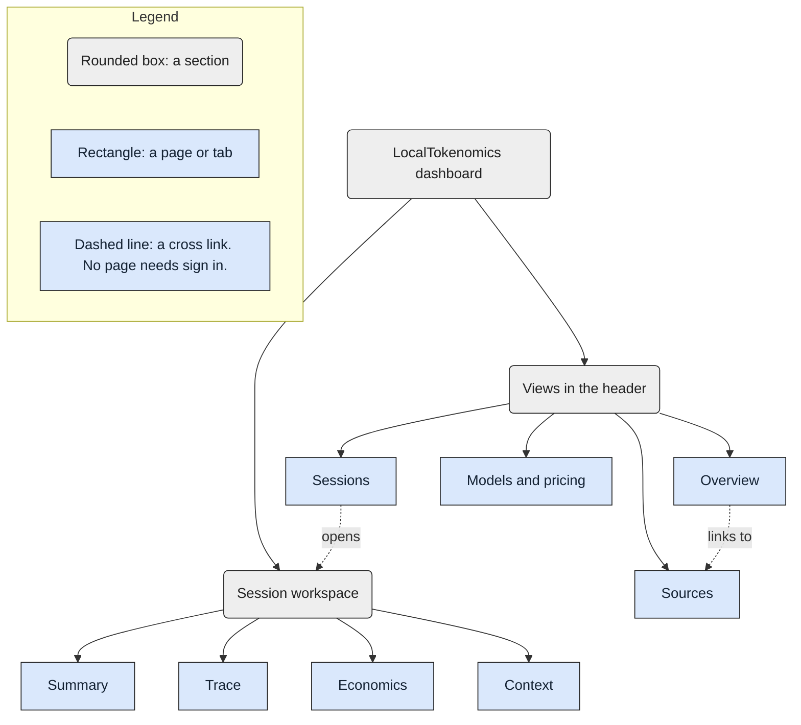

# Web Sitemap

This map shows every page of the dashboard and how the pages are grouped. A reader sees that there are four views and one session panel with four tabs. None of them needs a sign in, because the dashboard runs on the reader's own machine.

## What the diagram shows

- The four views are named in the header tab strip `web/src/Header.tsx:24-24`.
- The workspace has four tabs, Summary, Trace, Economics and Context `web/src/SessionWorkspace.tsx:72-72`.
- The dashboard has no routes: the view and the open session are component state in App `web/src/App.tsx:136-137`.
- All requests go to relative paths under api on the same server `web/src/api.ts:503-503` `web/src/api.ts:539-540`.

## Capability and related functionality

The transitions between these pages are in [[Web Screen Flow]] and the layout of each page in its screen note, starting at [[App Screen]]. The server side of the paths belongs to [[Web API]].

## Web Sitemap

%% generated:diagram-web-information-architecture start (do not edit; run brain docs generate) %%

%% generated:diagram-web-information-architecture end %%

> [!example]- Code references
> | Code | What it shows |
> |---|---|
> | `web/src/Header.tsx:24-24` | The four views are named in the header tab strip |
> | `web/src/SessionWorkspace.tsx:72-72` | The workspace has four tabs, Summary, Trace, Economics and Context |
> | `web/src/App.tsx:136-137` | The dashboard has no routes: the view and the open session are component state in App |
> | `web/src/api.ts:503-503` | All requests go to relative paths under api on the same server |
> | `web/src/api.ts:539-540` | All requests go to relative paths under api on the same server |
