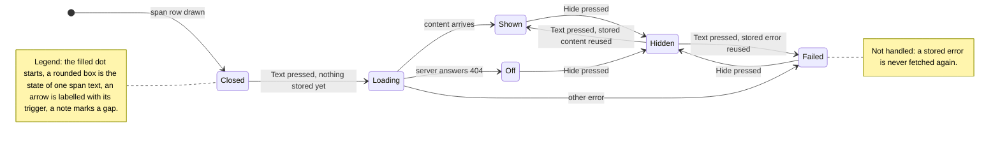

# Web Trace State Chart

This chart shows what happens when a reader opens the text of one step in a session trace. The text is fetched once and kept, so opening it again is instant. The chart also shows that a failed fetch is kept as well and is not tried again.

## What the diagram shows

- Text toggles the span open; the fetch runs only when nothing is stored for that span `web/src/TraceTab.tsx:786-791`.
- The state is set to loading, then to ready, off for a 404, or error `web/src/TraceTab.tsx:792-797`.
- A 404 is recognised by the text of the error message `web/src/TraceTab.tsx:59-61`.
- The content block is drawn only while the span is open and a state is stored `web/src/TraceTab.tsx:836-837`.

## Capability and related functionality

The chart belongs to [[Trace Tab Screen]]. The workspace level loading is in [[Web Workspace State Chart]], and the failures are collected in [[Web Error Flow]].

## Web Trace State Chart

%% generated:diagram-web-trace-content start (do not edit; run brain docs generate) %%

%% generated:diagram-web-trace-content end %%

> [!example]- Code references
> | Code | What it shows |
> |---|---|
> | `web/src/TraceTab.tsx:786-791` | Text toggles the span open; the fetch runs only when nothing is stored for that span |
> | `web/src/TraceTab.tsx:792-797` | The state is set to loading, then to ready, off for a 404, or error |
> | `web/src/TraceTab.tsx:59-61` | A 404 is recognised by the text of the error message |
> | `web/src/TraceTab.tsx:836-837` | The content block is drawn only while the span is open and a state is stored |
