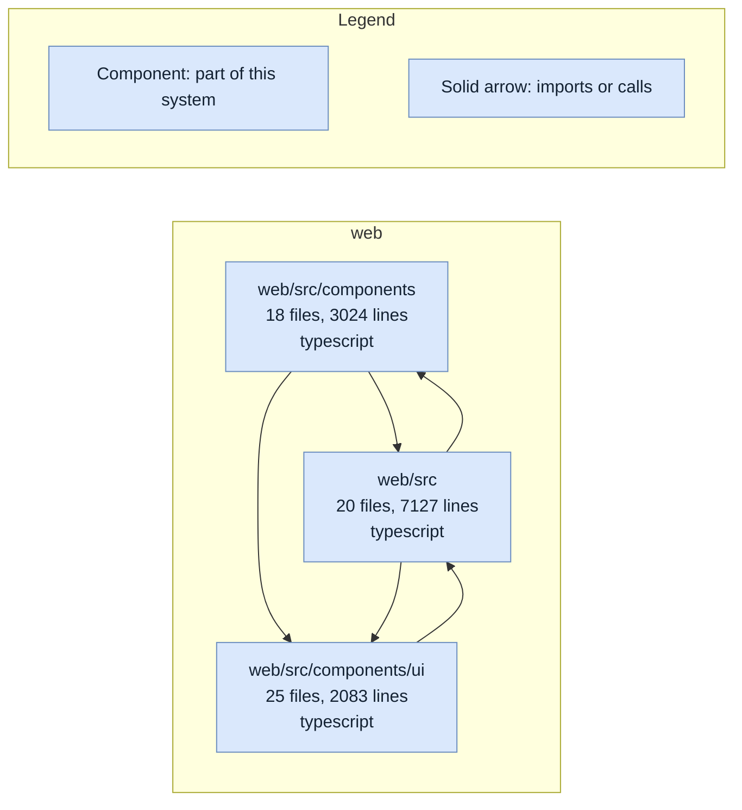

# Web UI components Diagrams

This view shows how the shared dashboard building blocks sit between the main web application and the lower-level interface primitives. It helps a reader see which direction dependencies run before changing a shared card, badge or chart.

## What the diagram shows

- The centre box is the set of shared dashboard components: stat cards, badges, charts, filters and session views `web/src/components/status.tsx:1-454`.
- An arrow from the components to the main web application exists because the badges import the data types, the design helper and the pricing notes from it `web/src/components/status.tsx:3-6`.
- An arrow from the components to the primitives box exists because the column chooser builds on the shared button and dropdown menu `web/src/components/columns.tsx:4-12`.
- An arrow from the main web application back to the components exists because the app screens import filters, stat cards and states from them `web/src/App.tsx:15-17`.
- An arrow from the primitives to the main web application exists because the button primitive uses the shared class name helper `web/src/components/ui/button.tsx:3`.

## Capability and related functionality

The diagram realises the shared display layer of the dashboard. The written explanation is in [[Web UI components Overview]], and the tests that guard it are in [[Web UI components Tests]]. The neighbouring modules are Web Overview and Web ui UI components Overview.

> [!example]- Code references
> | Code | Role |
> |---|---|
> | `web/src/components/status.tsx:3-6` | Imports from the main web application |
> | `web/src/components/columns.tsx:4-12` | Imports from the primitives |
> | `web/src/App.tsx:15-17` | Application imports of the components |
> | `web/src/components/ui/button.tsx:3` | Primitive importing the shared helper |

## Components around Web UI components

%% generated:diagram-module-ch-localtokenomics-web-src-components start (do not edit; run brain docs generate) %%

%% generated:diagram-module-ch-localtokenomics-web-src-components end %%
