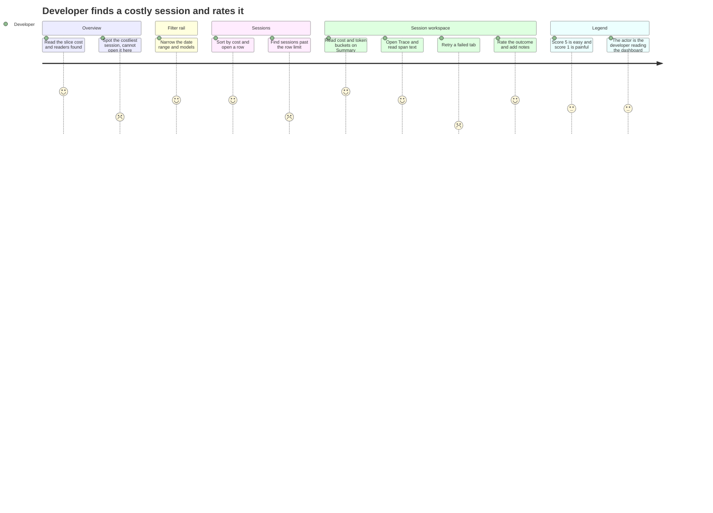

# Web User Journey

This journey follows a developer who wants to find one expensive session and judge it. It shows where the dashboard makes the work easy and where it gets in the way. The low scores point at gaps the code leaves open.

## What the diagram shows

- The overview shows the slice cost and the readers found, but its heaviest sessions rows cannot be opened `web/src/Overview.tsx:194-194` `web/src/Overview.tsx:424-424` `web/src/Overview.tsx:437-437`.
- The filter rail narrows the date range and the models `web/src/FilterRail.tsx:320-329` `web/src/FilterRail.tsx:381-381`.
- The sessions table sorts by cost and opens a row, and stops at the row limit `web/src/Sessions.tsx:51-51` `web/src/Sessions.tsx:48-48`.
- Summary shows cost and token buckets without a request of its own `web/src/SessionWorkspace.tsx:202-224`.
- Trace loads span text on demand `web/src/TraceTab.tsx:793-793`.
- A failed tab shows its error with no retry `web/src/SessionWorkspace.tsx:389-390`.
- The outcome is rated and notes are saved from the workspace header `web/src/SessionWorkspace.tsx:533-533`.

## Capability and related functionality

The screens on the way are [[Overview Screen]], [[App Screen]], [[Sessions Screen]] and [[Session Workspace Screen]]. The underlying use cases, such as inspecting and rating a session, are in [[Web Specification]].

## Web User Journey

%% generated:diagram-web-review-session start (do not edit; run brain docs generate) %%

%% generated:diagram-web-review-session end %%

> [!example]- Code references
> | Code | What it shows |
> |---|---|
> | `web/src/Overview.tsx:194-194` | The overview shows the slice cost and the readers found, but its heaviest sessions rows cannot be opened |
> | `web/src/Overview.tsx:424-424` | The overview shows the slice cost and the readers found, but its heaviest sessions rows cannot be opened |
> | `web/src/Overview.tsx:437-437` | The overview shows the slice cost and the readers found, but its heaviest sessions rows cannot be opened |
> | `web/src/FilterRail.tsx:320-329` | The filter rail narrows the date range and the models |
> | `web/src/FilterRail.tsx:381-381` | The filter rail narrows the date range and the models |
> | `web/src/Sessions.tsx:51-51` | The sessions table sorts by cost and opens a row, and stops at the row limit |
> | `web/src/Sessions.tsx:48-48` | The sessions table sorts by cost and opens a row, and stops at the row limit |
> | `web/src/SessionWorkspace.tsx:202-224` | Summary shows cost and token buckets without a request of its own |
> | `web/src/TraceTab.tsx:793-793` | Trace loads span text on demand |
> | `web/src/SessionWorkspace.tsx:389-390` | A failed tab shows its error with no retry |
> | `web/src/SessionWorkspace.tsx:533-533` | The outcome is rated and notes are saved from the workspace header |
