# Web Workspace State Chart

This chart shows how each tab of an open session waits for its data. A tab asks the server only when the reader first opens it, which keeps the panel fast. The chart also shows that a failed tab stays failed until the session is reopened.

## What the diagram shows

- A tab is requested the first time it is selected, and only requested tabs fetch `web/src/SessionWorkspace.tsx:452-455` `web/src/SessionWorkspace.tsx:472-474`.
- A disabled resource reports idle, an enabled one loading until its promise settles, then ready or error `web/src/SessionWorkspace.tsx:93-110`.
- Idle and loading show a Loading placeholder, an error shows the endpoint note with the message `web/src/SessionWorkspace.tsx:379-391`.
- The workspace is keyed by source and session id, so opening another session mounts a fresh one `web/src/App.tsx:344-344`.

## Capability and related functionality

The chart belongs to [[Session Workspace Screen]] and to the tabs [[Trace Tab Screen]], [[Economics Tab Screen]] and [[Context Tab Screen]]. The shell level states are in [[Web App Load State Chart]].

## Web Workspace State Chart

%% generated:diagram-web-workspace-loading start (do not edit; run brain docs generate) %%

```mermaid
stateDiagram-v2
    direction LR
    [*] --> Idle: workspace opens on a tab
    Idle --> Loading: tab selected the first time
    Loading --> Ready: endpoint answers
    Loading --> Failed: endpoint fails
    Ready --> Ready: tab selected again, no refetch
    Failed --> Failed: tab selected again, no retry
    Ready --> [*]: workspace closed or another session opened
    Failed --> [*]: workspace closed or another session opened
    note right of Failed
        Not handled: no retry action; the error text is shown under the endpoint note.
    end note
    note left of Idle
        Legend: the filled dot starts, the ringed dot ends, a rounded box is a tab state, an arrow is labelled with its trigger. Summary needs no fetch; Trace, Economics and Context each run this chart.
    end note
```

%% generated:diagram-web-workspace-loading end %%

> [!example]- Code references
> | Code | What it shows |
> |---|---|
> | `web/src/SessionWorkspace.tsx:452-455` | A tab is requested the first time it is selected, and only requested tabs fetch |
> | `web/src/SessionWorkspace.tsx:472-474` | A tab is requested the first time it is selected, and only requested tabs fetch |
> | `web/src/SessionWorkspace.tsx:93-110` | A disabled resource reports idle, an enabled one loading until its promise settles, then ready or error |
> | `web/src/SessionWorkspace.tsx:379-391` | Idle and loading show a Loading placeholder, an error shows the endpoint note with the message |
> | `web/src/App.tsx:344-344` | The workspace is keyed by source and session id, so opening another session mounts a fresh one |
