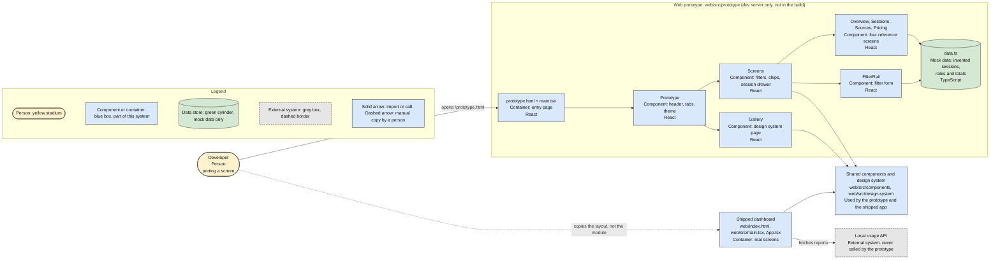

# Web prototype C4 components

This view shows the experimental copy of the dashboard that lives beside the real one. It lets a designer or developer try the four screens and the design system against made up numbers, with no usage logs needed. It also shows that the real dashboard is a separate program, so nobody mistakes the mock screens for the product.

## What the diagram shows

A developer opens the prototype page on the development server, and that page loads the prototype entry script `web/prototype.html:25-25` `web/src/prototype/main.tsx:1-11`. The entry script mounts the `Prototype` shell, which holds the tabs, the theme toggle and the header buttons `web/src/prototype/Prototype.tsx:20-112`.

The shell shows either the design system page or the `Screens` component `web/src/prototype/Prototype.tsx:98-107`. `Screens` keeps the filter form state and the open session drawer, and draws the filter rail `web/src/prototype/Screens.tsx:266-378`. The rail is a fixed column on wide windows and a slide-in sheet on narrow ones `web/src/prototype/Rail.tsx:245-276`. `Screens` then renders one of the four reference screens `web/src/prototype/Screens.tsx:360-368`.

The screens and the rail read only from the mock data file. It holds literal totals and a generated list of sessions `web/src/prototype/data.ts:617-632` `web/src/prototype/data.ts:698-742`. No call to the local usage API appears in the prototype folder, so the API is drawn as an external system that the prototype never reaches.

Both the prototype and the shipped dashboard import the same shared components and design system `web/src/prototype/Screens.tsx:3-24` `web/src/App.tsx:14-18`. The shipped dashboard has its own entry script and its own page `web/src/main.tsx:3-13` `web/index.html:26-26`, and it does fetch real data from the API `web/src/App.tsx:168-169` `web/src/App.tsx:186-186`.

A developer porting a screen reads the matching prototype file and copies its layout into the real file. The migration guide says to copy the composition, not the module `web/src/design-system/MIGRATION.md:38-40`. That is the dashed arrow in the diagram.

## Capability and related functionality

The prototype realises one capability: a clickable, data free reference for how the dashboard screens and the design system should look. It serves the people who build the dashboard, not the people who read their costs. The notes around it are [[Web prototype Overview]] for the file by file explanation, [[Web prototype Diagrams]] for the generated import view, and Web Overview and Web UI components Overview for the shipped dashboard and the shared parts it uses.

> [!example]- Code references
> | Code | What it shows |
> |---|---|
> | `web/prototype.html:25-25` | The prototype page loads its own entry script |
> | `web/src/prototype/main.tsx:1-11` | The entry script mounts the shell |
> | `web/src/prototype/Prototype.tsx:20-112` | The shell, with tabs, theme toggle and staged header buttons |
> | `web/src/prototype/Screens.tsx:266-378` | Filter state, chips, rail, active screen and session drawer |
> | `web/src/prototype/Screens.tsx:360-368` | The choice of one of the four screens |
> | `web/src/prototype/Rail.tsx:245-276` | The filter rail in its two layouts |
> | `web/src/prototype/Gallery.tsx:161-173` | The design system page |
> | `web/src/prototype/data.ts:617-632` | Literal mock totals |
> | `web/src/prototype/data.ts:698-742` | Generated mock sessions |
> | `web/src/App.tsx:14-18` | The shipped app imports the same shared parts |
> | `web/src/App.tsx:168-169` | The shipped app fetches metadata and rates |
> | `web/src/main.tsx:3-13` | The shipped entry script |
> | `web/src/design-system/MIGRATION.md:38-40` | Copy the layout, not the module |

## Web prototype C4 components

%% generated:diagram-web-prototype-c4 start (do not edit; run brain docs generate) %%

%% generated:diagram-web-prototype-c4 end %%
