# Web prototype component tree

This view shows how the prototype page is built from smaller parts, from the entry script down to the shared building blocks. A developer can see which parts belong only to the prototype and which come from the shared component folders. It answers where to change a given panel.

## What the diagram shows

The entry script mounts the shell component in strict mode `web/src/prototype/main.tsx:1-11`.

The shell renders its header buttons, a separator and the toaster, then either the gallery or the screens component `web/src/prototype/Prototype.tsx:31-110` `web/src/prototype/Prototype.tsx:98-107`.

The screens component renders the filter rail, the filter chips, one of four screens and the session drawer `web/src/prototype/Screens.tsx:342-377`.

The filter rail renders the same filter content twice, once in a fixed column and once in a sheet `web/src/prototype/Rail.tsx:260-273`. The content uses the shared search, chip, date range and facet components `web/src/prototype/Rail.tsx:93-175`.

The overview screen is a stack of seven small panel components `web/src/prototype/OverviewScreen.tsx:370-386`. Each panel uses the shared panel parts `web/src/prototype/OverviewScreen.tsx:47-85`.

The sessions screen renders cards or a table, depending on the window width `web/src/prototype/SessionsScreen.tsx:127-240`. The sources screen renders reader blocks, a folded list and a warnings list `web/src/prototype/SourcesScreen.tsx:15-92`. The pricing screen renders three panels `web/src/prototype/PricingScreen.tsx:208-218`.

The session drawer renders sections from the shared detail and trace components `web/src/prototype/Screens.tsx:84-264`. The gallery imports the same shared parts to show them side by side `web/src/prototype/Gallery.tsx:48-80`.

## Capability and related functionality

The capability is a map of reuse: which parts a screen owns and which it borrows. It belongs with [[Web prototype Overview]], the module view in [[Web prototype Diagrams]], and the shared parts described in the notes on the components chunks.

## Web prototype component tree

%% generated:diagram-prototype-render-tree start (do not edit; run brain docs generate) %%

```mermaid
flowchart TD
    main["main.tsx"]:::page
    proto["Prototype"]:::page
    screens["Screens"]:::page
    gallery["Gallery"]:::page
    overview["OverviewScreen"]:::page
    sessions["SessionsScreen"]:::page
    sources["SourcesScreen"]:::page
    pricing["PricingScreen"]:::page
    rail["FilterRail, RailContent"]:::local
    drawer["SessionDrawer"]:::local
    ovparts["DetectedSources, KpiRow, TimeChartPanel, CostByModelPanel, TokenMixPanel, CacheSavingsPanel, ByProjectPanel"]:::local
    prparts["RateTablePanel, MultipliersPanel, UnpricedPanel"]:::local
    sharedpanel["Panel, PanelHeader, PanelBody, PanelNote"]:::shared
    sharedfilter["FilterChips, SortSelect, SearchField, ChipRow, DateRange, FacetGroup"]:::shared
    sharedsession["SessionCard, TokenCell, SourceCard, SourceDetail"]:::shared
    sharedstatus["CostStateBadge, OutcomeBadge, BucketBar, MeterRow, ComparisonMeter, Legend"]:::shared
    sharedstate["EmptyState, DisclosurePanel, WarningsList, SortButton"]:::shared
    shareddetail["Section, MetaGrid, PathList, CodeBlock, ContextOccupancy, SpanTimeline, InsightList, CapabilityGrid"]:::shared
    sharedchart["Stat, StatGrid, Sparkline, TimeChart"]:::shared
    prim["Button, Sheet, Table, Tooltip, Badge, ToggleGroup, Switch, Separator, Toaster"]:::primitive

    main --> proto
    proto --> screens
    proto --> gallery
    proto --> prim
    screens --> rail
    screens --> sharedfilter
    screens --> overview
    screens --> sessions
    screens --> sources
    screens --> pricing
    screens --> drawer
    rail --> prim
    rail --> sharedfilter
    rail --> sharedstate
    overview --> ovparts
    ovparts --> sharedpanel
    ovparts --> sharedchart
    ovparts --> sharedsession
    ovparts --> sharedstatus
    ovparts --> prim
    sessions --> sharedpanel
    sessions --> sharedfilter
    sessions --> sharedsession
    sessions --> sharedstatus
    sessions --> sharedstate
    sessions --> prim
    sources --> sharedpanel
    sources --> sharedsession
    sources --> sharedstate
    pricing --> prparts
    prparts --> sharedpanel
    prparts --> shareddetail
    prparts --> sharedstatus
    prparts --> prim
    drawer --> prim
    drawer --> shareddetail
    drawer --> sharedstatus
    drawer --> sharedstate
    gallery --> sharedpanel
    gallery --> sharedfilter
    gallery --> sharedsession
    gallery --> sharedstatus
    gallery --> sharedstate
    gallery --> shareddetail
    gallery --> sharedchart
    gallery --> prim

    subgraph Legend
        direction LR
        zl1["Page or screen component: thick border. An arrow reads as renders"]:::page
        zl2["Component defined in web/src/prototype: blue box"]:::local
        zl3["Shared component from web/src/components: green box"]:::shared
        zl4["UI primitive from web/src/components/ui over a third party kit: grey dashed box"]:::primitive
        zl1 ~~~ zl2
        zl2 ~~~ zl3
        zl3 ~~~ zl4
    end

    classDef page fill:#dae8fc,stroke:#222222,stroke-width:4px,color:#111111
    classDef local fill:#dae8fc,stroke:#222222,color:#111111
    classDef shared fill:#d5e8d4,stroke:#222222,color:#111111
    classDef primitive fill:#e6e6e6,stroke:#222222,stroke-dasharray:5 3,color:#111111
```

%% generated:diagram-prototype-render-tree end %%

%% generated:node-citations-prototype-render-tree start (do not edit; run brain docs generate) %%
### Node citations

- main: `web/src/prototype/main.tsx:1-11`
- proto: `web/src/prototype/Prototype.tsx:20-112`
- screens: `web/src/prototype/Screens.tsx:266-378`
- gallery: `web/src/prototype/Gallery.tsx:161-173`
- overview: `web/src/prototype/OverviewScreen.tsx:370-386`
- sessions: `web/src/prototype/SessionsScreen.tsx:82-249`
- sources: `web/src/prototype/SourcesScreen.tsx:8-95`
- pricing: `web/src/prototype/PricingScreen.tsx:208-218`
- rail: `web/src/prototype/Rail.tsx:80-80`, `web/src/prototype/Rail.tsx:245-276`
- drawer: `web/src/prototype/Screens.tsx:84-264`
- ovparts: `web/src/prototype/OverviewScreen.tsx:42-42`, `web/src/prototype/OverviewScreen.tsx:88-88`, `web/src/prototype/OverviewScreen.tsx:151-151`, `web/src/prototype/OverviewScreen.tsx:218-218`, `web/src/prototype/OverviewScreen.tsx:257-257`, `web/src/prototype/OverviewScreen.tsx:309-309`, `web/src/prototype/OverviewScreen.tsx:343-343`
- prparts: `web/src/prototype/PricingScreen.tsx:46-46`, `web/src/prototype/PricingScreen.tsx:130-130`, `web/src/prototype/PricingScreen.tsx:172-172`
- sharedpanel: `web/src/prototype/OverviewScreen.tsx:5-5`
- sharedfilter: `web/src/prototype/Rail.tsx:6-6`, `web/src/prototype/SessionsScreen.tsx:12-12`, `web/src/prototype/Screens.tsx:12-12`
- sharedsession: `web/src/prototype/SessionsScreen.tsx:13-13`, `web/src/prototype/OverviewScreen.tsx:16-16`, `web/src/prototype/SourcesScreen.tsx:3-3`
- sharedstatus: `web/src/prototype/OverviewScreen.tsx:9-15`
- sharedstate: `web/src/prototype/SourcesScreen.tsx:4-4`, `web/src/prototype/SessionsScreen.tsx:14-14`, `web/src/prototype/Rail.tsx:9-9`
- shareddetail: `web/src/prototype/Screens.tsx:11-11`, `web/src/prototype/Screens.tsx:16-16`
- sharedchart: `web/src/prototype/OverviewScreen.tsx:4-8`
- prim: `web/src/prototype/Prototype.tsx:4-7`, `web/src/prototype/Screens.tsx:3-10`, `web/src/prototype/SessionsScreen.tsx:3-10`
%% generated:node-citations-prototype-render-tree end %%

> [!example]- Code references
> | Code | What it shows |
> |---|---|
> | `web/src/prototype/main.tsx:1-11` | Entry script that mounts the shell |
> | `web/src/prototype/Prototype.tsx:98-107` | Gallery or screens |
> | `web/src/prototype/Screens.tsx:342-377` | Rail, chips, screens and drawer |
> | `web/src/prototype/Rail.tsx:260-273` | Rail in a column and in a sheet |
> | `web/src/prototype/OverviewScreen.tsx:370-386` | Seven panels |
> | `web/src/prototype/PricingScreen.tsx:208-218` | Three panels |
> | `web/src/prototype/Gallery.tsx:48-80` | Shared parts the gallery imports |
