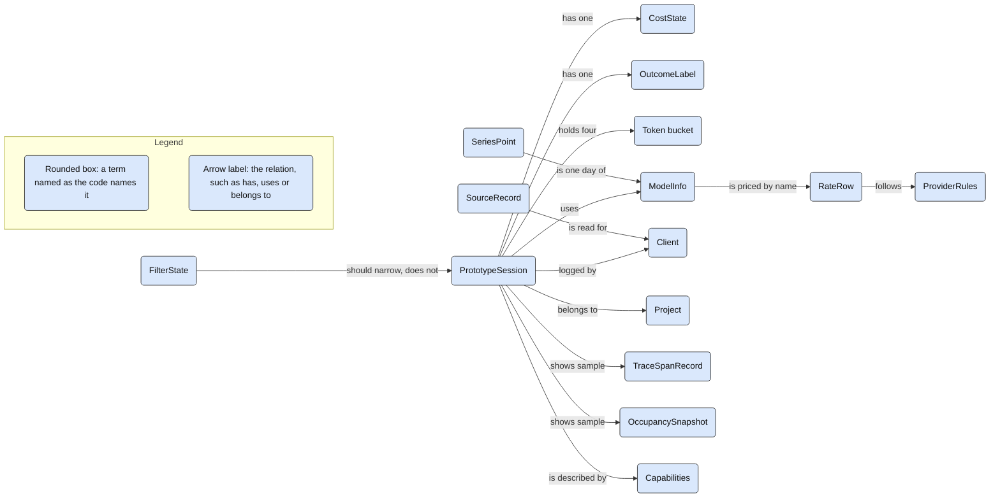

# Web prototype glossary map

This map lists the words the prototype uses for its sample data and how they relate. A session belongs to a project, uses a model and is logged by a client. Knowing these terms makes every screen easier to read.

## What the diagram shows

A session record holds a project, a client, a list of models, token counts, a cost state, an outcome, a traced flag and an error count `web/src/prototype/data.ts:170-196`.

The cost state is one of four values: priced, free, unpriced and unavailable `web/src/prototype/Screens.tsx:71-82` `web/src/prototype/Rail.tsx:26-26`. The outcome is one of five: successful, partial, failed, abandoned and unrated `web/src/prototype/Rail.tsx:28-28`.

A session holds four token buckets: uncached input, cache read, cache write and output `web/src/prototype/data.ts:170-196`.

A model carries a provider, a client and a state `web/src/prototype/data.ts:15-27`. A rate row is matched to a model by the same name string, not by a link `web/src/prototype/data.ts:29-31` `web/src/prototype/data.ts:572-580` `web/src/prototype/data.ts:583-583`.

A rate follows the rules of its provider, and the pricing screen falls back to a default when the provider has no rule `web/src/prototype/PricingScreen.tsx:33-44`.

A series point is one model on one day `web/src/prototype/data.ts:125-134`. A reader record lists the clients it can read `web/src/prototype/data.ts:419-433`.

Trace spans and context snapshots are fixed sample lists, shown for any traced session `web/src/prototype/data.ts:765-772` `web/src/prototype/data.ts:791-799` `web/src/prototype/Screens.tsx:171-215`. Capabilities say what a source can know `web/src/prototype/data.ts:757-763`.

The filter state is meant to narrow sessions but is never passed to a screen `web/src/prototype/Rail.tsx:30-44` `web/src/prototype/Screens.tsx:360-368`.

## Capability and related functionality

The capability is a shared vocabulary for the screens. Business meaning of these words in the real product is described in the glossary of the specification, see [[Web prototype Specification]], and the data shapes in [[Web prototype Data Model]].

## Web prototype glossary map

%% generated:diagram-prototype-terms start (do not edit; run brain docs generate) %%

%% generated:diagram-prototype-terms end %%

%% generated:node-citations-prototype-terms start (do not edit; run brain docs generate) %%
### Node citations

- session: `web/src/prototype/data.ts:170-196`
- cost: `web/src/prototype/Screens.tsx:71-82`
- outcome: `web/src/prototype/Rail.tsx:28-28`
- bucket: `web/src/prototype/data.ts:170-196`
- model: `web/src/prototype/data.ts:15-27`
- rate: `web/src/prototype/data.ts:572-580`
- rules: `web/src/prototype/data.ts:597-608`
- client: `web/src/prototype/data.ts:152-159`
- source: `web/src/prototype/data.ts:419-433`
- project: `web/src/prototype/data.ts:161-168`
- point: `web/src/prototype/data.ts:125-134`
- span: `web/src/prototype/data.ts:791-799`
- snap: `web/src/prototype/data.ts:765-772`
- cap: `web/src/prototype/data.ts:757-763`
- filt: `web/src/prototype/Rail.tsx:30-44`
%% generated:node-citations-prototype-terms end %%

> [!example]- Code references
> | Code | What it shows |
> |---|---|
> | `web/src/prototype/data.ts:170-196` | The session record |
> | `web/src/prototype/data.ts:15-27` | The model record |
> | `web/src/prototype/data.ts:572-608` | Rates and provider rules |
> | `web/src/prototype/data.ts:765-799` | Context snapshots and trace spans |
> | `web/src/prototype/Rail.tsx:26-44` | Cost states, outcomes and filter state |
