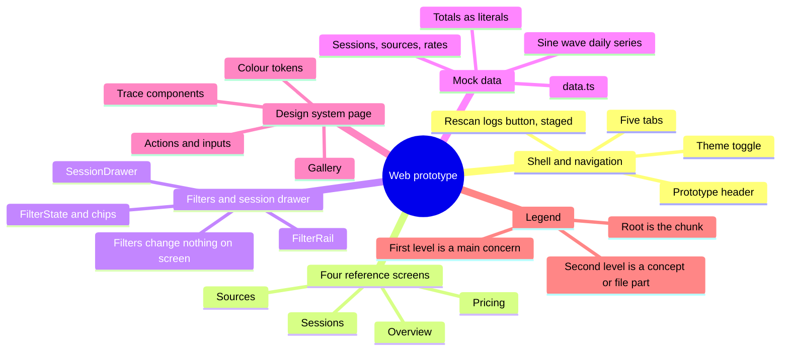

# Web prototype mind map

This picture gives a newcomer the whole prototype on one page. It names the five parts that matter: the shell, the four screens, the filters and the session drawer, the sample data and the design system page. It helps a person decide which file to open first.

## What the diagram shows

The shell is one header with five tabs, a theme button and a rescan button `web/src/prototype/Prototype.tsx:34-96`. The tab list holds the four screens and the design system page `web/src/prototype/Prototype.tsx:14-18`. The rescan button only flips a flag for 900 milliseconds `web/src/prototype/Prototype.tsx:26-29`.

The four screens are named once and chosen by a plain conditional `web/src/prototype/Screens.tsx:41-48` `web/src/prototype/Screens.tsx:360-368`.

The filter rail edits a filter state and the chips show it `web/src/prototype/Rail.tsx:30-44` `web/src/prototype/Screens.tsx:283-340`. The session drawer opens from a row and shows cost, tokens and trace `web/src/prototype/Screens.tsx:84-264`. The screens are rendered without any filter value, so the filters change nothing on screen `web/src/prototype/Screens.tsx:360-368`.

The sample data takes only its type names from the real API module `web/src/prototype/data.ts:1-1`. Totals are literal numbers `web/src/prototype/data.ts:617-632`, daily series come from a sine function `web/src/prototype/data.ts:9-13`, and sessions are repeated from a short seed list `web/src/prototype/data.ts:698-742`.

The design system page is one long gallery with eight sections, from colour tokens `web/src/prototype/Gallery.tsx:173-173` to trace components `web/src/prototype/Gallery.tsx:621-621`.

## Capability and related functionality

The capability is orientation: one picture that maps the folder to the five concerns a reader meets. It sits above the detailed views, [[Web prototype C4 components]] for the containers, [[Web prototype component tree]] for what renders what, and [[Web prototype Overview]] for the file by file text.

## Web prototype mind map

%% generated:diagram-prototype-concepts start (do not edit; run brain docs generate) %%

%% generated:diagram-prototype-concepts end %%

> [!example]- Code references
> | Code | What it shows |
> |---|---|
> | `web/src/prototype/Prototype.tsx:14-96` | Tabs, header and staged rescan button |
> | `web/src/prototype/Screens.tsx:41-48` | The four screen names |
> | `web/src/prototype/Screens.tsx:266-378` | Filter state, chips, active screen and drawer |
> | `web/src/prototype/Rail.tsx:30-44` | The filter state fields |
> | `web/src/prototype/data.ts:617-632` | Literal totals |
> | `web/src/prototype/Gallery.tsx:173-173` | First gallery section |
