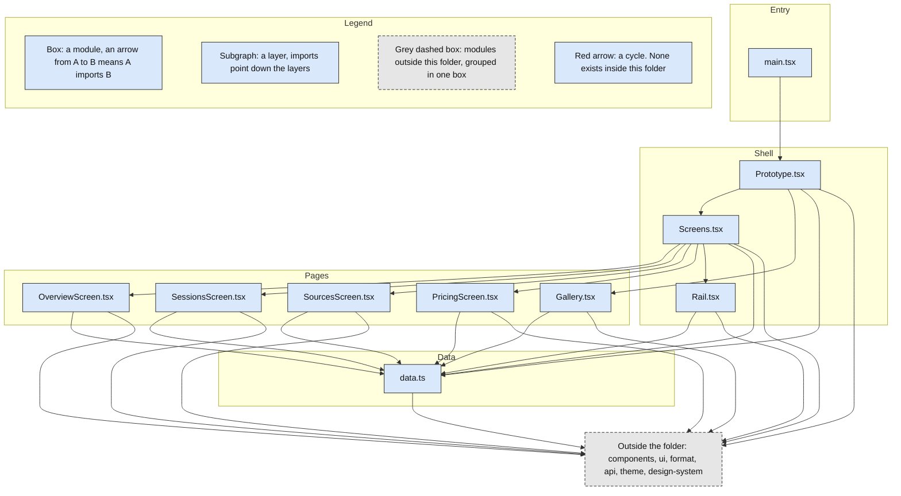

# Web prototype module dependencies

This view shows which files of the prototype import which, as layers from the entry script down to the sample data. Imports run in one direction and no cycle exists inside the folder. A developer can change a screen without worrying about hidden loops.

## What the diagram shows

The entry script imports the shell `web/src/prototype/main.tsx:5-5`. The shell imports the gallery, the screens component and the sample data `web/src/prototype/Prototype.tsx:10-12`.

The screens component imports the four screens, the filter rail and the sample data `web/src/prototype/Screens.tsx:25-39`.

Each screen imports only the sample data from its own folder `web/src/prototype/OverviewScreen.tsx:25-35` `web/src/prototype/SessionsScreen.tsx:20-20` `web/src/prototype/SourcesScreen.tsx:6-6` `web/src/prototype/PricingScreen.tsx:18-18`. The rail and the gallery do the same `web/src/prototype/Rail.tsx:12-24` `web/src/prototype/Gallery.tsx:82-90`.

The sample data file imports only type names from the shared API module `web/src/prototype/data.ts:1-1`.

Everything else comes from outside the folder: shared components, UI primitives, formatting, the theme and the design system `web/src/prototype/Prototype.tsx:4-9` `web/src/prototype/Screens.tsx:3-24`. The diagram groups them in one box. The folder level graph is in [[Web prototype Diagrams]].

## Capability and related functionality

The capability is a clear boundary: the prototype depends on the shared code, and [[Web prototype Overview]] states that no other chunk depends on it. The component view is [[Web prototype component tree]].

## Web prototype module dependencies

%% generated:diagram-prototype-imports start (do not edit; run brain docs generate) %%

%% generated:diagram-prototype-imports end %%

%% generated:node-citations-prototype-imports start (do not edit; run brain docs generate) %%
### Node citations

- main: `web/src/prototype/main.tsx:1-11`
- proto: `web/src/prototype/Prototype.tsx:10-12`
- screens: `web/src/prototype/Screens.tsx:25-39`
- rail: `web/src/prototype/Rail.tsx:12-24`
- ov: `web/src/prototype/OverviewScreen.tsx:25-35`
- se: `web/src/prototype/SessionsScreen.tsx:20-20`
- so: `web/src/prototype/SourcesScreen.tsx:6-6`
- pr: `web/src/prototype/PricingScreen.tsx:18-18`
- ga: `web/src/prototype/Gallery.tsx:82-90`
- data: `web/src/prototype/data.ts:1-1`
- ext: `web/src/prototype/Prototype.tsx:4-9`
%% generated:node-citations-prototype-imports end %%

> [!example]- Code references
> | Code | What it shows |
> |---|---|
> | `web/src/prototype/main.tsx:4-5` | Entry imports |
> | `web/src/prototype/Prototype.tsx:4-12` | Shell imports |
> | `web/src/prototype/Screens.tsx:25-39` | Screens imports |
> | `web/src/prototype/data.ts:1-1` | Type only import |
