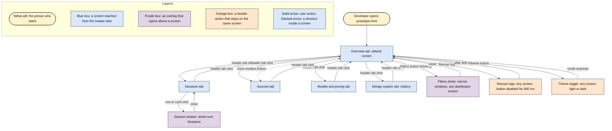

# Web prototype screen flow

This diagram shows how a person moves between the screens of the prototype. Every screen is one click from every other, and the only deeper steps are the session drawer and the filters sheet. A designer can hold it next to the real dashboard and compare the paths.

## What the diagram shows

The page opens on the overview tab `web/src/prototype/Prototype.tsx:22-22`.

Each header tab calls the tab setter, so any tab reaches any other, including the design system page `web/src/prototype/Prototype.tsx:49-67` `web/src/prototype/Prototype.tsx:16-16`.

A row button on the overview moves the user to the sources tab `web/src/prototype/OverviewScreen.tsx:76-82`. The screens component supplies that move `web/src/prototype/Screens.tsx:361-361`.

A click on a session row opens the drawer `web/src/prototype/SessionsScreen.tsx:168-172`, and the chosen session is kept as the active one `web/src/prototype/Screens.tsx:363-363`. Closing the sheet clears it `web/src/prototype/Screens.tsx:94-94` `web/src/prototype/Screens.tsx:375-375`.

The Filters button appears on every tab but the gallery and is hidden on wide windows `web/src/prototype/Prototype.tsx:70-79`. It opens a left sheet that holds the filter content `web/src/prototype/Rail.tsx:264-273`.

Rescan logs disables its button for 900 milliseconds and reads nothing `web/src/prototype/Prototype.tsx:26-29` `web/src/prototype/Prototype.tsx:83-86`. The theme button flips between light and dark `web/src/prototype/Prototype.tsx:87-94`.

## Capability and related functionality

The capability is navigation between the four reference screens and the design system page. The structure of the pages is in [[Web prototype sitemap]], the states behind the moves are in [[Web prototype shell UI states]], and the journey of a developer is in [[Web prototype user journey]].

## Web prototype screen flow

%% generated:diagram-prototype-navigation start (do not edit; run brain docs generate) %%

%% generated:diagram-prototype-navigation end %%

%% generated:node-citations-prototype-navigation start (do not edit; run brain docs generate) %%
### Node citations

- start: `web/prototype.html:25-25`
- overview: `web/src/prototype/Prototype.tsx:22-22`
- sessions: `web/src/prototype/Prototype.tsx:16-16`
- sources: `web/src/prototype/Screens.tsx:361-361`
- pricing: `web/src/prototype/Screens.tsx:43-48`
- gallery: `web/src/prototype/Prototype.tsx:98-107`
- drawer: `web/src/prototype/Screens.tsx:84-264`
- railsheet: `web/src/prototype/Rail.tsx:264-273`
- rescan: `web/src/prototype/Prototype.tsx:26-29`
- theme: `web/src/prototype/Prototype.tsx:87-94`
%% generated:node-citations-prototype-navigation end %%

> [!example]- Code references
> | Code | What it shows |
> |---|---|
> | `web/src/prototype/Prototype.tsx:49-67` | Header tabs |
> | `web/src/prototype/OverviewScreen.tsx:76-82` | Shortcut to Sources |
> | `web/src/prototype/SessionsScreen.tsx:168-172` | Row click opens the drawer |
> | `web/src/prototype/Screens.tsx:361-375` | Shortcut wiring and drawer close |
> | `web/src/prototype/Rail.tsx:264-273` | Filters sheet |
> | `web/src/prototype/Prototype.tsx:26-29` | Staged rescan |
