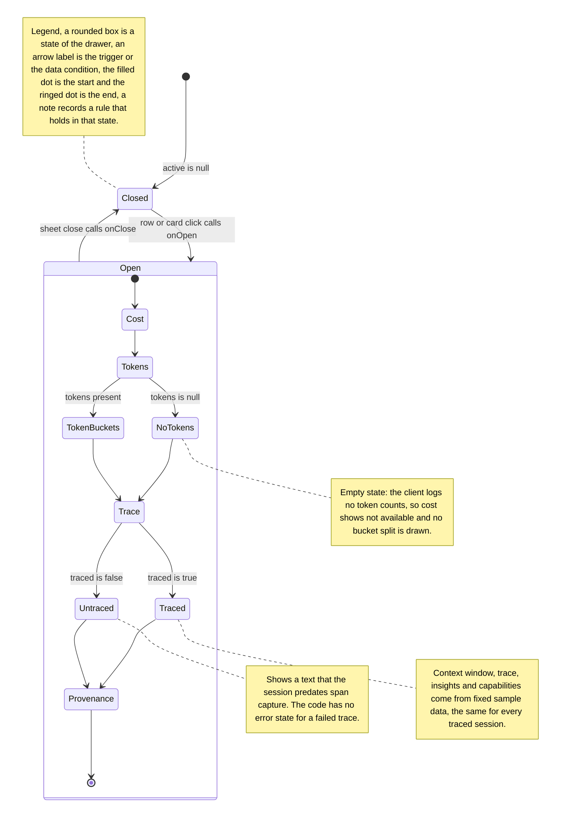

# Web prototype session drawer states

This chart follows the session drawer from closed to open and through its sections. It shows which parts appear only when the tool logged token counts or span data. It also shows which cases get a sentence of explanation instead of an empty box.

## What the diagram shows

The drawer is closed while no session is active `web/src/prototype/Screens.tsx:278-278` `web/src/prototype/Screens.tsx:94-94`. A click on a row or card opens it `web/src/prototype/Screens.tsx:363-363`, and its close control clears the session `web/src/prototype/Screens.tsx:375-375`.

The cost section is always drawn, with the cost state, the outcome and a sentence that explains how the cost came about `web/src/prototype/Screens.tsx:110-123` `web/src/prototype/Screens.tsx:71-82`.

Token buckets are drawn when the session has token counts. Without them the drawer shows an empty state that says the tool logs no token counts `web/src/prototype/Screens.tsx:125-169`.

A traced session gets the context window, the trace, the insights and the capability grid. Any other session gets a text that says it was recorded before span capture `web/src/prototype/Screens.tsx:171-224`. The traced blocks read fixed sample arrays, the same for every session `web/src/prototype/Screens.tsx:181-213`.

The provenance, log file and reprice sections are always drawn `web/src/prototype/Screens.tsx:226-257`.

## Capability and related functionality

The capability is the detail view of one session. It is opened from [[Sessions Screen Screen]], and the shell around it is charted in [[Web prototype shell UI states]].

## Web prototype session drawer states

%% generated:diagram-session-drawer-states start (do not edit; run brain docs generate) %%

%% generated:diagram-session-drawer-states end %%

> [!example]- Code references
> | Code | What it shows |
> |---|---|
> | `web/src/prototype/Screens.tsx:84-264` | The drawer component |
> | `web/src/prototype/Screens.tsx:125-169` | Tokens or empty state |
> | `web/src/prototype/Screens.tsx:171-224` | Traced or untraced |
> | `web/src/prototype/Screens.tsx:266-281` | Active session state |
