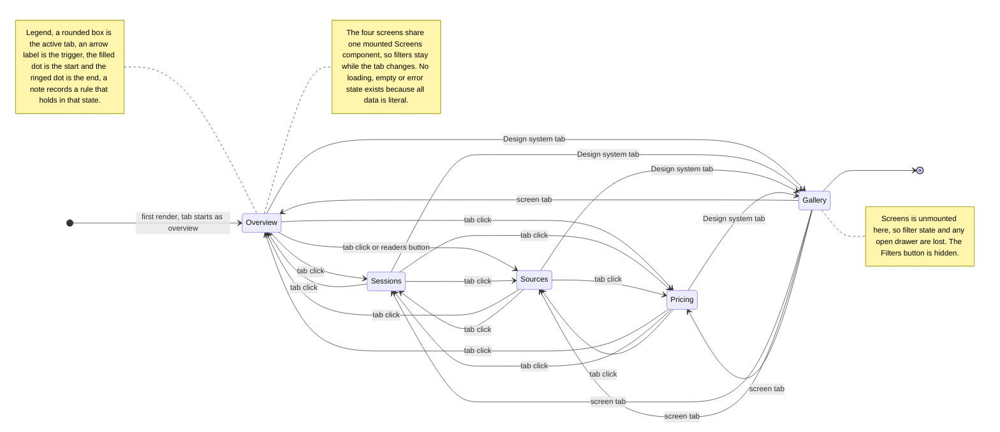

# Web prototype shell UI states

This chart shows the modes the prototype header can be in: which screen is active and what happens when the design system tab is chosen. It points out that filters are lost on a visit to the design system and that no loading or error state exists. Both matter to anyone copying this behaviour.

## What the diagram shows

The shell starts on the overview tab `web/src/prototype/Prototype.tsx:22-22`.

A tab click sets the tab, and any tab can follow any other `web/src/prototype/Prototype.tsx:49-67`. The overview also moves to sources through its row button `web/src/prototype/Screens.tsx:361-361`.

The gallery tab swaps the screens component for the gallery `web/src/prototype/Prototype.tsx:98-107`. The screens component owns the filter state and the active session `web/src/prototype/Screens.tsx:277-278`, so leaving it for the gallery drops both, and returning starts from the initial filters.

The Filters button is drawn only when the tab is not the gallery `web/src/prototype/Prototype.tsx:70-79`.

No state waits for data: totals are literal and sessions are built when the module loads `web/src/prototype/data.ts:617-632` `web/src/prototype/data.ts:698-742`. The shell has no loading, empty or error state.

## Capability and related functionality

The capability is the behaviour of the five tab shell. The routes between states are drawn as a flow in [[Web prototype screen flow]], and the drawer has its own chart in [[Web prototype session drawer states]].

## Web prototype shell UI states

%% generated:diagram-shell-ui-states start (do not edit; run brain docs generate) %%

%% generated:diagram-shell-ui-states end %%

> [!example]- Code references
> | Code | What it shows |
> |---|---|
> | `web/src/prototype/Prototype.tsx:20-29` | Tab, rail and scanning state |
> | `web/src/prototype/Prototype.tsx:98-107` | Gallery or screens |
> | `web/src/prototype/Screens.tsx:277-281` | Filter and drawer state kept in Screens |
> | `web/src/prototype/data.ts:698-742` | Sessions built at load |
