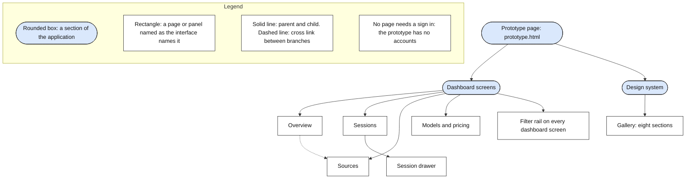

# Web prototype sitemap

This map lists every place a person can go in the prototype and how the places nest. There are two sections, the dashboard screens and the design system page. No place needs a sign in.

## What the diagram shows

The whole prototype is one page that loads one entry script `web/src/prototype/main.tsx:1-11`. The places are tabs of that page, not separate addresses `web/src/prototype/Prototype.tsx:14-18`.

The dashboard section holds four screens, Overview, Sessions, Sources and Models and pricing `web/src/prototype/Screens.tsx:41-48`. A filter rail sits beside each of them `web/src/prototype/Screens.tsx:344-350`.

The Sessions screen leads to the session drawer `web/src/prototype/Screens.tsx:363-363`.

The Overview screen has a cross link to Sources `web/src/prototype/OverviewScreen.tsx:76-82`. It is the only link that joins two screens other than the tabs.

The design system section is the gallery, with eight sections that start at colour tokens `web/src/prototype/Gallery.tsx:173-173` and end at trace components `web/src/prototype/Gallery.tsx:621-621`.

The shell shows all tabs at once and asks for no account `web/src/prototype/Prototype.tsx:31-110`.

## Capability and related functionality

The capability is a plain list of what exists, which a designer can use to check coverage against the real dashboard. The moves between places are in [[Web prototype screen flow]], and the labels of each screen are in the four screen notes, for example [[Sessions Screen Screen]].

## Web prototype sitemap

%% generated:diagram-prototype-pages start (do not edit; run brain docs generate) %%

%% generated:diagram-prototype-pages end %%

%% generated:node-citations-prototype-pages start (do not edit; run brain docs generate) %%
### Node citations

- root: `web/prototype.html:25-25`
- dash: `web/src/prototype/Screens.tsx:41-48`
- ds: `web/src/prototype/Prototype.tsx:14-18`
- ov: `web/src/prototype/OverviewScreen.tsx:370-386`
- se: `web/src/prototype/SessionsScreen.tsx:82-249`
- so: `web/src/prototype/SourcesScreen.tsx:8-95`
- pr: `web/src/prototype/PricingScreen.tsx:208-218`
- sd: `web/src/prototype/Screens.tsx:84-264`
- ga: `web/src/prototype/Gallery.tsx:173-173`, `web/src/prototype/Gallery.tsx:621-621`
- rail: `web/src/prototype/Screens.tsx:344-350`
%% generated:node-citations-prototype-pages end %%

> [!example]- Code references
> | Code | What it shows |
> |---|---|
> | `web/src/prototype/Prototype.tsx:14-18` | Tab list |
> | `web/src/prototype/Screens.tsx:41-48` | Screen names |
> | `web/src/prototype/Gallery.tsx:173-173` | First gallery section |
> | `web/src/prototype/Gallery.tsx:621-621` | Last gallery section |
> | `web/src/prototype/OverviewScreen.tsx:76-82` | Cross link to Sources |
