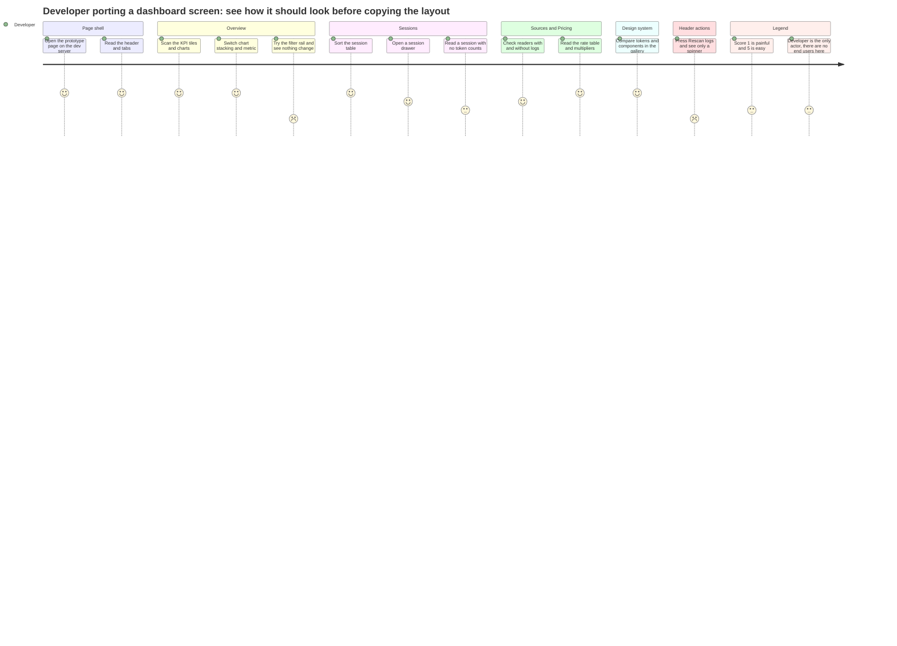

# Web prototype user journey

This journey follows a developer who wants to port a dashboard screen and first looks at the prototype. Most steps are easy, and the two low points are controls that look live and do nothing. That tells a reader where the prototype could mislead.

## What the diagram shows

The developer opens the prototype page, which loads the shell with its header and tabs `web/src/prototype/Prototype.tsx:34-96`.

On the overview the developer scans the tiles and charts, and can switch the chart stacking and metric `web/src/prototype/OverviewScreen.tsx:370-386` `web/src/prototype/OverviewScreen.tsx:178-198`.

The filter rail edits state and shows chips, but the screens are rendered without the filters, so nothing changes. That is the first low score `web/src/prototype/Screens.tsx:277-281` `web/src/prototype/Screens.tsx:360-368`.

On Sessions the developer sorts the table and opens a drawer `web/src/prototype/SessionsScreen.tsx:99-105` `web/src/prototype/SessionsScreen.tsx:168-172`. A session without token counts shows an empty state, which is a middle score `web/src/prototype/Screens.tsx:164-169`.

Sources shows readers with and without logs `web/src/prototype/SourcesScreen.tsx:15-80`, and Pricing shows the rate table and multipliers `web/src/prototype/PricingScreen.tsx:46-170`.

The gallery shows tokens and components side by side `web/src/prototype/Gallery.tsx:161-173`.

Pressing Rescan logs only spins a button for 900 milliseconds, which is the second low score `web/src/prototype/Prototype.tsx:26-29`.

## Capability and related functionality

The capability is the guided review of the reference screens. The paths between screens are in [[Web prototype screen flow]], and the places are listed in [[Web prototype sitemap]].

## Web prototype user journey

%% generated:diagram-designer-porting-journey start (do not edit; run brain docs generate) %%

%% generated:diagram-designer-porting-journey end %%

> [!example]- Code references
> | Code | What it shows |
> |---|---|
> | `web/src/prototype/Prototype.tsx:26-29` | Staged rescan |
> | `web/src/prototype/Screens.tsx:360-368` | Screens get no filter value |
> | `web/src/prototype/SessionsScreen.tsx:99-105` | Sorting |
> | `web/src/prototype/Screens.tsx:164-169` | Empty state without token counts |
