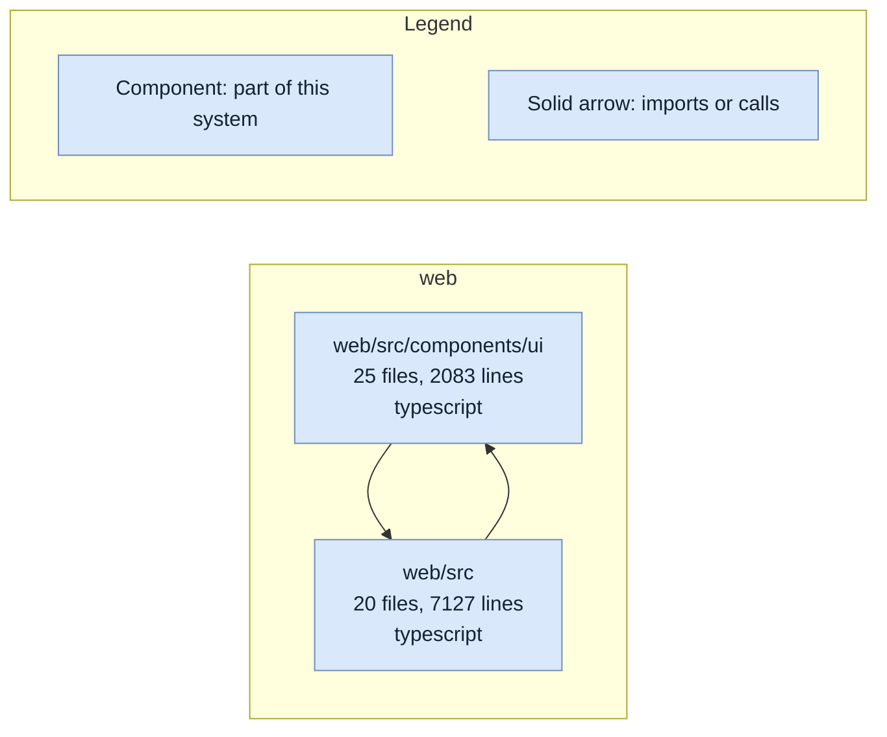

# Web ui UI components Diagrams

This view shows how the shared building blocks of the dashboard connect to the screens that use them. It lets a reader see at a glance that the building blocks sit below the screens and carry no business logic of their own. That matters when someone wants to change the look of the whole dashboard in one place.

## What the diagram shows

The left box is the folder of interface building blocks, and the right box is the rest of the dashboard source. The arrow from the screens to the building blocks exists because screens import buttons, tables and tooltips from the folder (web/src/FilterRail.tsx:9-13, web/src/main.tsx:4). The arrow back exists because the toast host reads the current theme from the dashboard theme module (web/src/components/ui/sonner.tsx:10-13). The building blocks otherwise import only each other, as the toggle group imports the toggle (web/src/components/ui/toggle-group.tsx:6) and the dialog imports the button (web/src/components/ui/dialog.tsx:8).

## Capability and related functionality

The diagram realises the shared design system layer described in [[Web ui UI components Overview]]. The screens that consume it are covered by the notes of the neighbouring chunks.

## Components around Web ui UI components

%% generated:diagram-module-ch-localtokenomics-web-src-components-ui start (do not edit; run brain docs generate) %%

%% generated:diagram-module-ch-localtokenomics-web-src-components-ui end %%

> [!example]- Code references
> | Part | Code |
> |---|---|
> | Button primitive | web/src/components/ui/button.tsx:1-63 |
> | Toast host reading the theme | web/src/components/ui/sonner.tsx:10-13 |
> | Screen composing primitives | web/src/FilterRail.tsx:9-13 |
