# Where usage cost data comes from

This view follows each piece of stored data from where it starts to where it ends up. It shows that usage figures come only from the logs on the machine and prices only from the bundled rate file. It also shows which stored data the person creates themselves, such as ratings and forgotten sessions.

## What the diagram shows

- Ingest walks every source root, parses each changed file and writes its requests, its spans and one files row with size, offset and warnings. `src/ai_usage_cost/store.py:218-298`
- A request is stored once per fingerprint, so the same record seen twice is not counted twice. `src/ai_usage_cost/store.py:23-24` `src/ai_usage_cost/store.py:376-386`
- The privacy settings decide which spans are skipped and how long trace rows are kept. `src/ai_usage_cost/pipeline.py:175-185` `src/ai_usage_cost/store.py:272-277` `src/ai_usage_cost/store.py:300-303`
- Spans of a forgotten session are skipped on the next ingest because the exclusions table is read first. `src/ai_usage_cost/store.py:213-216` `src/ai_usage_cost/store.py:273-274`
- Load reads every stored request in time order and collects the warnings kept on each files row. `src/ai_usage_cost/store.py:691-699`
- Each loaded request is priced against the rate table read from rates.json. `src/ai_usage_cost/pipeline.py:192-199` `src/ai_usage_cost/pricing.py:286-287`
- Span counts, error counts and ratings per session are read from the trace and outcome tables and used by the report filters. `src/ai_usage_cost/pipeline.py:188` `src/ai_usage_cost/store.py:628-661` `src/ai_usage_cost/pipeline.py:322-334`
- The report leaves the tool as JSON, a PNG chart, terminal text or an alert message. `src/ai_usage_cost/cli.py:95-105` `src/ai_usage_cost/cli.py:186-196` `src/ai_usage_cost/cli.py:339-352`
- A rating from the dashboard replaces the outcome row of its session, and forgetting a session deletes its spans and rating and writes an exclusion row. `src/ai_usage_cost/store.py:572-584` `src/ai_usage_cost/store.py:595-606`
- The GPU sampler writes one samples row per reading, and the SQL browser serves the whole store, samples included. `src/ai_usage_cost/collect.py:271-277` `src/ai_usage_cost/cli.py:238-248`

## Capability and related functionality

- The tables are listed field by field in [[Ai usage cost Data Model]], and the data flow with its process numbers is drawn in [[Usage data flow]].
- The privacy settings that filter the lineage are explained in [[Ai usage cost Security]].
- Forgetting a session keeps its requests, a gap recorded as a risk in [[Ai usage cost Specification]].

## Where usage cost data comes from

%% generated:diagram-usage-cost-data-origins start (do not edit; run brain docs generate) %%

```mermaid
flowchart LR
    logs(["AI coding tool logs"]):::outside
    ratesfile(["rates.json"]):::outside
    cfgfile(["config.json"]):::outside
    gpu(["GPU tools and Ollama"]):::outside
    viewer(["Person in the dashboard"]):::outside

    ingest["ingest"]:::process
    collect["collect"]:::process
    load["load"]:::process
    price["price_event"]:::process
    report["report_of"]:::process
    rate["rate_session and forget_session"]:::process
    sqlview["sql (Datasette)"]:::process

    requests[("requests")]:::store
    files[("files")]:::store
    traces[("trace_events")]:::store
    outcomes[("outcomes")]:::store
    exclusions[("session_exclusions")]:::store
    samples[("samples")]:::store

    out_json(["JSON, PNG, terminal, alert"]):::outside

    logs -->|usage records| ingest
    logs -->|trace records| ingest
    cfgfile -->|exclude_projects, retention| ingest
    ingest -->|one row per fingerprint| requests
    ingest -->|mtime, size, offset, warnings| files
    ingest -->|spans| traces
    exclusions -->|excluded sessions| ingest
    requests -->|stored requests| load
    files -->|scan warnings| load
    load -->|usage events| price
    ratesfile -->|rate rows| price
    price -->|priced events| report
    traces -->|span and error counts| report
    outcomes -->|ratings| report
    report -->|Report| out_json
    viewer -->|rating, notes, tags| rate
    rate -->|outcome row| outcomes
    rate -->|exclusion row| exclusions
    gpu -->|utilisation, memory, power| collect
    collect -->|sample rows| samples
    samples -->|sample rows| sqlview

    subgraph Legend
        direction LR
        zlegend_a[("Data store: a table of usage.db")]:::store
        zlegend_b["Process that reads or writes it"]:::process
        zlegend_c(["Outside source or sink"]):::outside
        zlegend_d["An arrow is named after the data that moves, not the action"]:::process
        zlegend_a ~~~ zlegend_b ~~~ zlegend_c ~~~ zlegend_d
    end

    classDef store fill:#d5e8d4,stroke:#222222,color:#222222
    classDef process fill:#dae8fc,stroke:#222222,color:#222222
    classDef outside fill:#f5f5f5,stroke:#666666,color:#222222,stroke-dasharray:4 3
```

%% generated:diagram-usage-cost-data-origins end %%

> [!example]- Code references
> | Code | What it shows |
> |---|---|
> | `src/ai_usage_cost/store.py:190-305` | Ingest of logs into the store |
> | `src/ai_usage_cost/store.py:668-699` | Load of stored requests |
> | `src/ai_usage_cost/pipeline.py:166-199` | Pricing of every loaded request |
> | `src/ai_usage_cost/store.py:568-606` | Rating and forgetting a session |
> | `src/ai_usage_cost/collect.py:260-282` | GPU sample collection |
