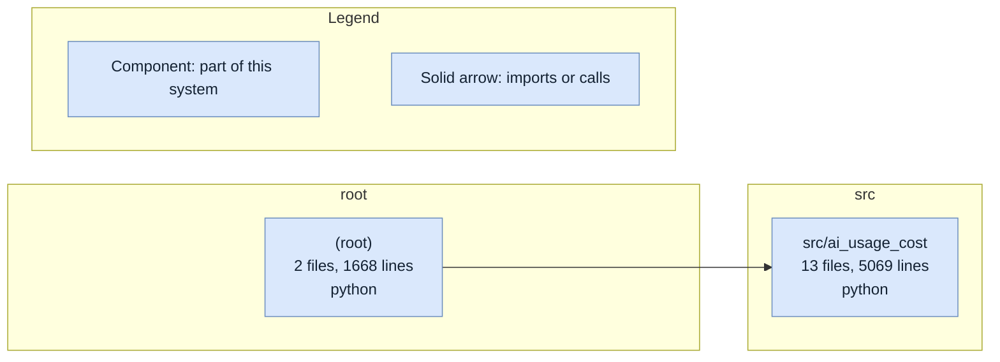

# localtokenomics root Diagrams

Generated views of the localtokenomics root chunk; hand-laid views are added next to them.

## Components around localtokenomics root

%% generated:diagram-module-ch-localtokenomics-root start (do not edit; run brain docs generate) %%

%% generated:diagram-module-ch-localtokenomics-root end %%
