# Web Ontology

This is the part of the project's knowledge graph that the code in Web defines. It shows what the code knows about, and how those things are linked to each other and to the rest of the project.

## What it contains

34 terms, of which 1 belong to other chunks and appear only so that links have somewhere to land.

| Kind | Count |
|---|---|
| actor | 1 |
| open-question | 2 |
| risk | 2 |
| rule | 18 |
| state-machine | 4 |
| system | 1 |
| use-case | 5 |

## Relations

| Relation | Count |
|---|---|
| uses | 6 |
| mentions | 4 |

## The graph

```mermaid
flowchart LR
    n0["Dashboard reader<br/>actor"]
    n1["Compare a dashboard screen with it<br/>use-case"]
    n2["Dashboard developer<br/>actor"]
    n3["Check list prices<br/>use-case"]
    n4["Inspect one session<br/>use-case"]
    n5["Rate a session outcome<br/>use-case"]
    n6["Read usage and cost for a period<br/>use-case"]
    n7["Automatic rescan every five minute<br/>rule"]
    n8["Cache price derivation<br/>rule"]
    n9["CostState lifecycle<br/>state-machine"]
    n10["Do not import from the prototype f<br/>rule"]
    n11["Outcome notes are saved only when <br/>rule"]
    n12["Prototype figures are invented<br/>rule"]
    n13["Prototype filters do not filter th<br/>rule"]
    n14["Prototype rescan is staged<br/>rule"]
    n15["Prototype session table shows at m<br/>rule"]
    n16["Prototype splits session cost acro<br/>rule"]
    n17["Question 3꞉ Does the DELETE sessio<br/>open-question"]
    n18["Question 4꞉ Is deleteSession reach<br/>open-question"]
    n19["Rate age notice thresholds<br/>rule"]
    n20["Rate row state<br/>rule"]
    n21["RateState lifecycle<br/>state-machine"]
    n22["Reported cost divergence threshold<br/>rule"]
    n23["Risk 1꞉ The dashboard client can w<br/>risk"]
    n24["Risk 2꞉ Most files in this chunk h<br/>risk"]
    n25["Session table row limit<br/>rule"]
    n26["SpanKind lifecycle<br/>state-machine"]
    n27["SpanStatus lifecycle<br/>state-machine"]
    n28["Sub cent money keeps four decimals<br/>rule"]
    n29["The prototype is excluded from the<br/>rule"]
    n30["Unattributed turn is excluded from<br/>rule"]
    n31["Unavailable is never shown as zero<br/>rule"]
    n32["Unpriced cost stays out of totals<br/>rule"]
    n33["Web prototype<br/>system"]
    n3 -->|uses| n0
    n1 -->|uses| n2
    n1 -->|mentions| n2
    n4 -->|uses| n0
    n5 -->|uses| n0
    n6 -->|uses| n0
    classDef k_actor fill:#fff2cc,stroke:#222222,color:#222222
    class n0,n2 k_actor
    classDef k_openquestion fill:#f5f5f5,stroke:#222222,color:#222222
    class n17,n18 k_openquestion
    classDef k_risk fill:#f8cecc,stroke:#222222,color:#222222
    class n23,n24 k_risk
    classDef k_rule fill:#e1d5e7,stroke:#222222,color:#222222
    class n7,n8,n10,n11,n12,n13,n14,n15,n16,n19,n20,n22,n25,n28,n29,n30,n31,n32 k_rule
    classDef k_statemachine fill:#ffe6cc,stroke:#222222,color:#222222
    class n9,n21,n26,n27 k_statemachine
    classDef k_system fill:#dae8fc,stroke:#222222,color:#222222
    class n33 k_system
    classDef k_usecase fill:#fff2cc,stroke:#222222,color:#222222
    class n1,n3,n4,n5,n6 k_usecase
```

The full slice is in `ch-localtokenomics-web-src.jsonld` beside this note. Project terms are the primary labels; ArchiMate, DDD, schema.org and Dublin Core terms annotate them.
