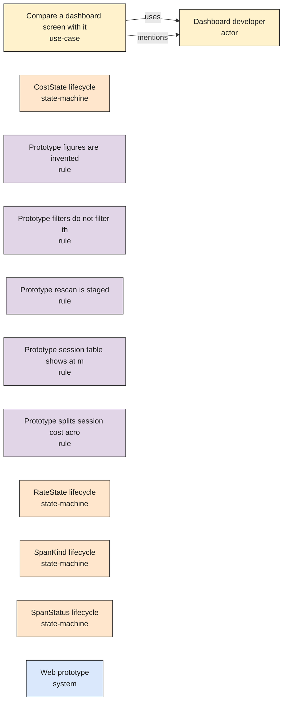

# Web prototype Ontology

This is the part of the project's knowledge graph that the code in Web prototype defines. It shows what the code knows about, and how those things are linked to each other and to the rest of the project.

## What it contains

12 terms, of which 1 belong to other chunks and appear only so that links have somewhere to land.

| Kind | Count |
|---|---|
| rule | 5 |
| state-machine | 4 |
| system | 1 |
| use-case | 1 |

## Relations

| Relation | Count |
|---|---|
| mentions | 4 |
| uses | 2 |

## The graph

The full slice is in `ch-localtokenomics-web-src-prototype.jsonld` beside this note. Project terms are the primary labels; ArchiMate, DDD, schema.org and Dublin Core terms annotate them.
